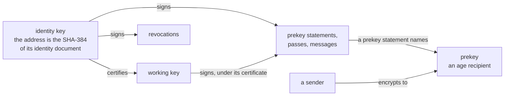
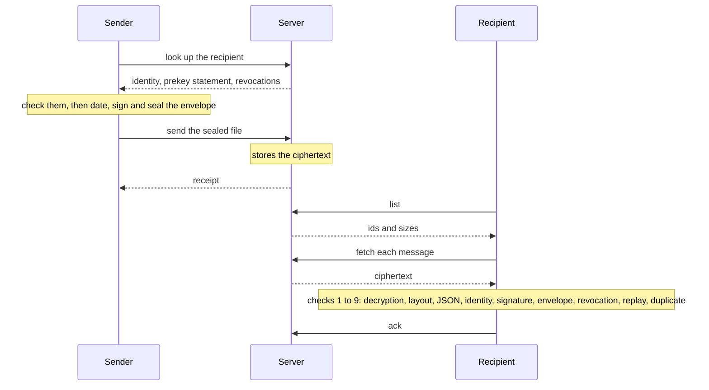

# The Dromas Protocol, version 1

**Status: draft.** Nothing here is final until version 1 is declared stable. The open issues of this repository and of dromas-server must be settled first.

## 1. Introduction

Dromas carries end-to-end encrypted, sender-authenticated messages between programs, through a store-and-forward server.

- A *mailbox* is named by its *address*, which is the hash of the mailbox's identity document. An address authenticates the key that it names, so no directory is needed.
- A sender encrypts a message to the recipient's *prekey*, which the recipient's identity signed. The sender signs the message inside the encryption.
- A mailbox signs with its identity, or with a *working key* that the identity certified to sign in the identity's place. With a working key, the identity can be kept away from daily work (Section 5).
- The server stores ciphertext. The server holds no private key, no plaintext and no signature over any message.

The keys, and the objects that each key signs (Sections 4 to 6, 10):



The life of one message (Sections 11.8, 11.10 to 11.13, 12.2, 12.3):



The server is not trusted for confidentiality or for authenticity. Clients make every check that protects a message. Section 15 states what a hostile server can and cannot do.

This document specifies the formats, the meaning of each HTTP operation, and the checks that a client and a server make. Alongside this document:

- **`api/openapi.yaml` is normative for the HTTP shapes:** routes, methods, request and answer members with their types, status codes, error codes and headers. This document says what each operation means, who may call each operation, which checks are made and what each refusal means. Where `api/openapi.yaml` and this document disagree, `api/openapi.yaml` is right about a shape, and this document is right about a meaning.
- **`testdata/vectors/` contains the conformance vectors (Section 16).**
- **`PRECEDENTS.md` sets each design decision beside the published standards and deployed systems that make the same decision.**

## 2. Conventions

### 2.1. Requirements language

The key words "MUST", "MUST NOT", "REQUIRED", "SHALL", "SHALL NOT", "SHOULD", "SHOULD NOT", "RECOMMENDED", "NOT RECOMMENDED", "MAY", and "OPTIONAL" in this document are to be interpreted as described in BCP 14 [RFC 2119] [RFC 8174] when, and only when, they appear in all capitals, as shown here.

### 2.2. Notation

- **Grammar.** Each text's form is given in ABNF (RFC 5234), in the section that defines the text, right after the prose that introduces the text.
  - A string in quotes matches in any ASCII case. A string written `%s"…"` matches exactly (RFC 7405).
  - The grammar uses the core rules by name (RFC 5234 Appendix B: `ALPHA`, `DIGIT`, `DQUOTE`, `LF`, `SP`).
  - The grammar also uses these rules by name: `full-date`, `time-hour` and `time-minute` (RFC 3339 §5.6), `OWS` and `BWS` (RFC 9110 §5.6.3), and `IPv6address` (RFC 3986 §3.2.2).
  - Appendix B collects every rule.
- A *line* ends in LF (0x0A). A text "of N lines" is exactly N lines. Such a text contains no CR, and nothing follows its last LF.
- `‖` is concatenation. `str(x)` is a uint32 big-endian length followed by the bytes of `x` (RFC 4251 §5).
- An **address** is written as `d_` followed by 64 characters of base64url (RFC 4648 §5) without padding: the rule `address` (Section 4.2). An address has this form wherever it appears: a path, a statement, an envelope, a namespace, a certificate's principal.
- A **time** is an RFC 3339 timestamp in UTC, to the second, with no leap second. A text with a second of `60` is not a time. An object that ends at a time is valid while a clock reads before that time. At that second, the object has ended.

  ```abnf
  time     = full-date %s"T" time-hour ":" time-minute ":" time-sec %s"Z"
  time-sec = %x30-35 DIGIT   ; 00 to 59
  ```

- A **serial** is a decimal integer from 1 to 2^53 − 1. The grammar states only a serial's digits. The largest integer that every JSON reader represents exactly is 2^53 − 1 (Section 3.3). A certificate serial, a prekey serial and a revocation serial (Section 2.3) are each a serial.

  ```abnf
  serial = %x31-39 *15DIGIT   ; no leading zero
  ```

- **base64** is standard base64 (RFC 4648 §4) in its one encoding: padded, with the unused bits of the last character zero. In this one encoding, encoding the decoded bytes again gives the same text. Two places differ from this definition, and each says so: the armour of a signature (Section 3.2) and an adopt key (Section 11.16).

  ```abnf
  base64            = *( 4base64-char ) [ base64-final ]
  base64-nonempty   = 1*( 4base64-char ) [ base64-final ] / base64-final
  base64-char       = ALPHA / DIGIT / "+" / "/"
  base64-final      = 2base64-char base64-char-by-4 "="
                    / base64-char base64-char-by-16 "=="
  base64-char-by-4  = %s"A" / %s"E" / %s"I" / %s"M" / %s"Q" / %s"U" / %s"Y"
                    / %s"c" / %s"g" / %s"k" / %s"o" / %s"s" / %s"w"
                    / "0" / "4" / "8"   ; its value a multiple of 4
  base64-char-by-16 = %s"A" / %s"Q" / %s"g" / %s"w"   ; its value a multiple of 16
  ```
- In a namespace or a statement, `<A>` is the address of the signing mailbox.
- In a route, `<A>` is the address of the mailbox that the call is about. The call is either a mailbox's call about itself, or anyone's lookup or revocation call (Sections 11.8, 11.15). `<B>` is the address of a message's recipient. A sender sends to `<B>` (Section 11.10), and the recipient calls the other message routes as itself (Sections 11.11 to 11.14).

### 2.3. Terms

Where this document uses a term below as a defined term, the term has the sense given here.

**Mailboxes and people**

- **Mailbox:** an address, together with the keys and the messages of that address.
- **Owner:** the party that runs a mailbox.
- **Reader:** the party that reads a text the protocol carries (Section 3.3). For a message, the reader is the recipient's client (Section 12.3).
- **Server**, **own server:** the mailbox server at which a mailbox is registered, and which the mailbox calls. The server comprises everything that the server's operator runs to answer at the server's name (Section 11.1).
- **Active**, **revoked**, **unknown:** the states of a mailbox at a server (Section 11.6).
- **Forgotten:** of a mailbox, no longer kept by the mailbox's server, after nothing valid for the mailbox is left (Section 13). A forgotten mailbox is unknown.
- **Identity holder:** the holder of a mailbox's identity key, when the mailbox does not keep that key itself (Section 12.7).

**Keys**

- **Identity key**, **the identity:** a mailbox's long-term signing key (Section 4.1).
- **Identity document `D`:** the two-line text that contains the identity's public key (Section 4.1).
- **Address:** the SHA-384 of the identity document (Section 4.2).
- **Working key:** a key that the identity certifies to sign in the identity's place (Section 5.2).
- **Certificate:** the OpenSSH user certificate by which the identity certifies a working key (Section 5.2). A certificate's **certificate serial** is the certificate's serial field.
- **The server's maximum:** the longest that a certificate the server accepts may run, given as the server's `max_certificate_lifetime` (Section 11.18).
- **Stolen:** of a key or a pass, possessed by a party that the owner did not give the key or pass to (Sections 12.6, 15.5).

**Signers and statements**

- **Statement:** a fixed-form text that a key signs (Section 3.2): a prekey statement (Section 6), a pass (Section 8) or a revocation statement (Section 10).
- **Signer:** the signing key of a prekey statement, a pass or a message, which is either the identity key or a certificate (Section 5). A signer's **rank** is the number that Section 5 gives the signer.
- **Prekey:** a mailbox's age encryption key, which a prekey statement contains (Section 6).
- **Prekey statement:** the statement that contains a prekey (Section 6). A prekey statement's **prekey serial** is the statement's serial, `p`.
- **Later, earlier:** of two prekey statements of one mailbox, their place in `(c, p)` order (Section 5.3).
- **Current statement:** the prekey statement that a server serves for a mailbox now (Section 11.8). The current statement has the **current prekey** as its key and the **current signer** as its signer, and a current signer that is a certificate is the **current certificate**.
- **Retired prekey:** a prekey once the server has accepted a later prekey statement (Section 11.9).
- **Prekey lifetime:** the time from when a client makes a prekey statement to when the statement ends (Sections 6, 12.4).
- **Pass:** a statement that a mailbox signs to prove itself to the mailbox's server on a call (Section 8).

**Revocations**

- **Revocation statement:** the statement that the identity signs to revoke the address (Section 10.1) or certificates (Section 10.2).
- **Revocation of the address:** the revocation statement that revokes an address (Section 10.1).
- **Revocation of certificates:** the revocation statement that revokes certificates through its **revocation serial**, the `through` value (Section 10.2): every certificate of the statement's address whose certificate serial is at or below the revocation serial.
- **Revocation record:** the JSON object that contains an identity's revocations (Section 10.3).
- **No revocation shown:** an answer that shows no revocation that a client can verify (Section 12.3, check 7).

**Operations**

- **Registration**, **register:** `PUT /v1/<A>` (Section 11.7).
- **Lookup**, **look up:** `GET /v1/<A>` (Section 11.8). A mailbox **looks itself up** at its own address.
- **Served:** as given by a server in the answer to a lookup (Section 11.8).
- **Renewal**, **renew:** publishing a new prekey statement, either by `PUT /v1/<A>/prekey` (Section 11.9) or, when the server has forgotten the mailbox, as a registration (Section 12.4).
- **Identical retry:** a registration or a renewal whose prekey statement and signature are byte for byte the ones that the server keeps as current. In a registration, the identity document is also byte for byte the one that the server keeps (Sections 11.7, step 5; 11.9).
- **Send:** `POST /v1/<B>/messages` (Section 11.10). A send's **receipt** is the send's `201` answer, or the `200` answer of the send's dedupe (Section 11.10, step 6).
- **List:** `GET /v1/<B>/messages`, which answers one page of a mailbox's messages (Section 11.11).
- **Poll:** a list without a cursor, or a list that carries a cursor but is not a continuation (Section 11.11).
- **Continuation:** a list that meets the three conditions of Section 11.11.
- **Long poll:** a list of the first page whose answer the server delays (Section 11.11).
- **Fetch:** `GET /v1/<B>/messages/<id>` (Section 11.12). A **refetch** is a fetch of a message that the mailbox has fetched before.
- **First-fetch budget:** the budget that a mailbox's first fetches of messages spend (Section 11.12).
- **Intake budget:** the number of messages that a mailbox accepts from all senders together (Section 11.10, step 8).
- **Ack:** `DELETE /v1/<B>/messages/<id>` (Section 11.13).
- **Set the ACL**, **get the ACL:** `PUT` and `GET /v1/<B>/acl` (Section 11.14).
- **Publish a revocation**, **look up revocations:** `PUT` and `GET /v1/<A>/revocations` (Section 11.15).
- **Join**, **leave:** `PUT` and `DELETE /v1/<A>/account` (Section 11.16). An **adopt key** is the key that a join carries.
- **The server's document:** the document that `GET /v1/` answers (Section 11.18).
- **Version floor:** the lowest version that a server accepts, given as the server's `min_version` (Section 11.17).

**Messages**

- **Envelope:** the signed JSON line that contains a message's metadata and body (Section 9.1).
- **Plaintext:** the bytes that are encrypted: the envelope, the envelope's signature and the padding (Section 9.2).
- **Message id:** the SHA-256 of a message's ciphertext, which is the `id` by which the message's server lists the message (Section 11.10).
- **`msg_id`:** the UUID that a sender gives a message (Section 9.1).
- **Native stanza:** an age recipient stanza of a type that a prekey has, `mlkem768x25519` (Section 9.4).
- **Seal:** pad the envelope and the envelope's signature, and encrypt the result to a prekey (Sections 9.3, 9.4).
- **Outbox entry:** a message that a client keeps to be sent, together with the message's envelope (Section 12.2).
- **Post:** one attempt to send an outbox entry (Section 12.2). A **copy** is the message as delivered by one post.
- **Live:** of a message, stored at the message's server and not yet **gone**. A gone message is one that is acked or expired (Sections 11.12, 11.13).
- **TTL:** 7 days (Sections 12.2; 12.3, check 6; 13).

**Clients**

- **Pinned:** of a peer's identity, kept by a client and used in place of the served identity (Section 12.2).
- **No answer:** the result that a client assigns to a call that failed, or to a call whose answer does not have the form that this document gives the answer (Sections 3.3, 11.1, 11.2, 12.3). No answer says nothing about the question that the call asked.
- **Malformed:** of a text or an answer, not in the form that this document gives it. A malformed answer is no answer.
- **Drain:** a client's run through the messages in the client's mailbox (Section 12.3).
- **Held:** of an accepted message, kept apart because the mailbox has not allowed the message's sender (Section 12.3).
- **Replay set:** the record that a client keeps of each message that the client accepted (Section 12.3, check 8).
- **Replay floor:** the cutoff to which a mailbox's replay set has been pruned (Section 12.3, check 8).
- **Deletion time:** the time by which a client deletes a retired prekey (Section 12.4).
- **Confirmed time:** of a renewal, the date of the pass that the client sent with the upload that the server accepted for the renewal (Section 12.4).
- **The remedy:** the steps of Section 12.6, for a stolen working key.

**Time**

- **Skew allowance:** one hour, which the maker of a time-limited object leaves for clocks that differ (Section 3.4).
- **Message margin:** the time that a client leaves before a certificate ends, for what the client signed under that certificate to be read.

## 3. Primitives

### 3.1. Algorithms

| Name | Role | Specification |
|---|---|---|
| age v1 | encryption to a prekey: `mlkem768x25519`, the hybrid ML-KEM-768 + X25519 recipient | C2SP age |
| Ed25519 | the identity key of type `ssh-ed25519`; the working key of an identity of either type of Section 4.1 | RFC 8032 |
| ECDSA P-256 | the identity key of type `ecdsa-sha2-nistp256` | FIPS 186-5, RFC 5656 |
| SSHSIG | every signature: the signer's signature over SHA-512 of the message, in a namespace | OpenSSH `PROTOCOL.sshsig` |
| SSH public key text | `<key type> <base64 of the wire key>` | RFC 4253 §6.6, RFC 8709, RFC 5656 |
| OpenSSH certificate | the certificate of a working key | draft-ietf-sshm-cert |
| SHA-384 | the address | FIPS 180-4 |
| SHA-256 | a message id | FIPS 180-4 |
| UUID | an envelope's `msg_id` | RFC 9562 |

Every keyed hash in this protocol is HMAC or HKDF, inside age. The protocol applies plain SHA-384 and SHA-256 only to public inputs: the identity document and the ciphertext.

### 3.2. Signatures

Every signature is an SSHSIG (`PROTOCOL.sshsig`) in one form: the bytes that `ssh-keygen -Y sign` writes. The signing key signs these bytes:

    "SSHSIG" ‖ str(namespace) ‖ str("") ‖ str("sha512") ‖ str(SHA-512(message))

The signature is this blob:

    "SSHSIG" ‖ u32(1) ‖ str(signing key) ‖ str(namespace) ‖ str("") ‖ str("sha512") ‖ str(signature)

The blob is armoured as `ssh-signature`: the blob's base64 (Section 2.2) in lines of 70 characters, with a last line of 1 to 70 characters, between a BEGIN line and an END line.

```abnf
ssh-signature    = %s"-----BEGIN SSH SIGNATURE-----" LF
                   signature-text
                   %s"-----END SSH SIGNATURE-----" LF
signature-text   = *( 2signature-line ) ( signature-even / signature-odd )
                   ; two lines of 70 hold 35 groups of 4
signature-line   = 70base64-char LF
signature-even   = signature-groups LF
signature-odd    = 68base64-char
                   ( 2base64-char LF 2base64-char [ signature-groups ]
                   / 2base64-char LF base64-char-by-4 "="
                   / base64-char base64-char-by-16 LF "==" ) LF
                   ; a group of 4 split across the last two lines
signature-groups = *16( 4base64-char ) ( 4base64-char / base64-final )
```

- **The signing key is the signer (Section 5), in SSH wire form.** When the identity signs, the signing key is the bare identity key: the bytes of the identity document's line 2. When a working key signs, the signing key is the certificate.
- **The signature is of the signing key's type.** For a certificate, the signature's type is the type of the key that the certificate certifies.
  - For `ssh-ed25519`: `str("ssh-ed25519") ‖ str(R ‖ S)`, 64 bytes (RFC 8709 §6).
  - For `ecdsa-sha2-nistp256`: `str("ecdsa-sha2-nistp256") ‖ str(mpint(r) ‖ mpint(s))` (RFC 5656 §3.1.2). Each mpint is as RFC 4251 §5 defines it, with a leading zero byte only where a set high bit needs one.
- **One form.** A verifier MUST parse the armour and the blob. The verifier MUST write the signature again in this form from the values it parsed. Where the written signature and the received signature differ by any byte, the verifier MUST refuse the signature before verifying the signature. So a verifier refuses every other way of writing a signature, including:
  - another line end or line length;
  - whitespace in the base64;
  - a byte before the BEGIN line or after the last LF;
  - a version other than 1, or a hash other than `sha512`;
  - a non-empty reserved field;
  - a NUL in a string;
  - an integer with an unneeded leading zero byte.
- **ECDSA's two values of s.** If (r, s) is a P-256 signature, (r, n − s) is also a P-256 signature, where n is the group's order (FIPS 186-5). Each of the two is a signature in the one form. A verifier MUST accept both, and a signer may write either. Anyone who has seen one of the two can write the other (Sections 5.2, 8). An Ed25519 signature has no second form.
- **A bound on size, per identity key type.** Each identity key type has a bound. The bound is the longest signature, in the one form, that a mailbox of that type can make with the mailbox's identity, or with a working key under a certificate as `ssh-keygen -s` makes one. Such a certificate has a 32-byte nonce, no extension and an empty reserved field (Section 5.2). In the one form, only the namespace and, for ECDSA, the lengths of r and s change a signature's size.

  | Identity key type | Bound | What reaches the bound |
  |---|---|---|
  | `ssh-ed25519` | exactly 850 bytes | a prekey statement under a certificate |
  | `ecdsa-sha2-nistp256` | 947 bytes | the same, with the identity's r and s on the certificate each in 33 bytes, the most the one form gives them |

  - The signature on everything that a mailbox signs is checked against the bound for the mailbox's identity key type. In a message, the bound limits the signature block, from the block's BEGIN line through the LF after the block's END line (Section 9.2).
  - Every verifier, a server included, MUST refuse a signature longer than the signing mailbox's bound before verifying the signature.
  - Every verifier MUST refuse a signature longer than the largest bound of any key type before reading the signature.
  - A key type added later states its own bound, and leaves the bounds of the other key types unchanged.
- **Ed25519's S.** In an SSHSIG and on a certificate, an Ed25519 signature's S is below the group order L (RFC 8032 §5.1.7).
- **The Ed25519 equation.** The equation is RFC 8032 §5.1.7's without the cofactor, `[S]B = R + [k]A'`, compared as encodings. So a verifier accepts a neutral R, and refuses R with a point of small order added.

### 3.3. JSON

A server and a client read every JSON text that the protocol carries by the rules below. These texts are a request body, an answer, an envelope (Section 9.1) with the body inside the envelope, a revocation record (Section 10.3), and what a client keeps of one. A reader refuses a text whole if the text fails a rule:

| Text | Refused as |
|---|---|
| a request | `400 bad_request` |
| an answer | no answer |
| an envelope | `bad_envelope` |

- **I-JSON (RFC 7493).** The text is UTF-8. In each object, each member name appears at most once, comparing names after their escapes are read. A name or a string contains no surrogate and no Unicode noncharacter, whether written directly or escaped.
- **One object.** The text is one object, and any bytes after the object are whitespace (space, tab, LF, CR). The text has no byte-order mark.
- **Names match exactly, case included.**
- **Numbers.** A number follows JSON's grammar (RFC 8259 §6). Every number's magnitude is at most the largest magnitude that a binary64 represents. A reader accepts a nonzero number too small for binary64.
- **Depth.** The depth is at most 32, with objects and arrays counted together and the outermost counted as one.
- **Types.** A member that the protocol defines is of the type defined for that member. A member that the protocol defines and whose value is null is the same as that member left out, except for the envelope's `body` (Section 9.1). An integer member is written in digits alone, from 0 to 2^53 − 1. For example, `1.0` and `1e0` are not integers.
- **Bytes.** A byte member is base64 (Section 2.2).
- **Unknown members.** An unknown member is a member that the reader does not know. A server MUST refuse an unknown member in anything sent to the server. Every other reader MUST ignore an unknown member: a client in an answer, and a mailbox in an envelope. The rules above still apply inside an unknown member.

### 3.4. Clocks

Every check of a time is exact at the clock of the party that makes the check. The check itself adds no time for clocks that differ. Instead, the maker of a time-limited object leaves the **skew allowance**, one hour, for clocks that differ. Each object's section states how the object's maker leaves the allowance:

- a certificate's start, at a verifier (Section 5.2);
- a prekey statement's ceiling, at a server (Section 6);
- a pass's lifetime (Section 8);
- a reader's limit on `sent_at` (Section 12.3, check 6);
- when a client renews a prekey whose prekey lifetime is a day or more (Section 12.4);
- how long a server keeps a message (Section 13).

A client that renews a prekey whose prekey lifetime is less than a day leaves five minutes instead (Section 12.4).

## 4. Identity and address

### 4.1. The identity document

The identity document `D` is two lines of ASCII: the tag, then one SSH public key written as `<key type> <base64 of the wire key>`, with no comment. For example:

```
dromas-v1
ssh-ed25519 AAAAC3NzaC1lZDI1NTE5AAAAI<43 characters>
```

The key MUST be of a type this section defines, in its one encoding, and MUST meet that type's key checks. The key's one encoding is the wire key that OpenSSH writes back after reading the key. Parsed as the type that line 2 names and written again, the key gives the same bytes. So one key has one document, and one address.

| Key type | Document | What fixes its one encoding | Key checks | Working key |
|---|---|---|---|---|
| `ssh-ed25519` | 91 bytes | the key's length, 32 (RFC 8709 §4) | a canonical point, not of small order | `ssh-ed25519` |
| `ecdsa-sha2-nistp256` | 171 bytes | the curve's name, `nistp256`, and an uncompressed point | the point on the curve, not the point at infinity, each coordinate below the field's size | `ssh-ed25519` |

- **Every client MUST verify every key type this section defines.** A client MUST NOT make an identity of a type other than `ssh-ed25519` unless the client's owner asks for one.
- **A key type defined after this version is OPTIONAL (Section 14).** Each client decides whether to verify such a type, and each server decides whether to register such a type (Section 11.7). Only a mailbox whose client verifies an optional type can write to a mailbox of that type, or hear from one (Section 7). This version defines no optional type.
- **Working key.** The table's Working key column gives the type of every working key that an identity of the row's type certifies (Section 5). A key type defined later states both its own working key type and its own signature bound (Section 3.2).
- **The form is the same for every key type, defined here or not.** An identity document has the form `identity-document`. In that form, `key-type` is a key type's name as RFC 4251 §6 writes one. The base64 is of an SSH wire key that begins with that same name.

  ```abnf
  identity-document = %s"dromas-v1" LF key-type SP base64-nonempty LF
  key-type          = key-name [ "@" domain ]   ; at most 64 characters
  key-name          = 1*( %x21-2B / %x2D-3F / %x41-7E )   ; printable ASCII, no "," or "@"
  domain            = domain-label 1*( "." domain-label )
  domain-label      = ( ALPHA / DIGIT ) [ *61( ALPHA / DIGIT / "-" ) ( ALPHA / DIGIT ) ]
  ```
- **A reader MUST refuse as `unsupported_key_type`, never as malformed, a well-formed document of a type that the reader does not verify (Section 15.4).**

### 4.2. The address

The address is the SHA-384 of `D`, written in 66 characters: the name of the address's form, `d`, then `_`, then the 48 bytes of the hash in base64url (RFC 4648 §5) without padding. For example, with OpenSSL: `printf d_; openssl dgst -sha384 -binary < identity.doc | openssl base64 -A | tr '+/' '-_'`. Base64url of 48 bytes needs no padding and leaves no unused bit, so each address has one text form:

```abnf
address      = address-form "_" 64base64url-char
address-form = %s"d"   ; the one form this version defines
```

- **SHA-384 is NIST's category 4 for collisions (SHA-256 is category 2).** The address is the one part of a mailbox that never changes. Whatever else of the mailbox is renewed, a second preimage of the address names the mailbox permanently.
- **The text before the first `_` names the address's form.** That first `_` is the delimiter, whatever follows it, because the name of a form never contains `_`. The 64 characters after the delimiter may begin with `-` or `_`. This version defines one form, `d`. A reader MUST refuse an address of any other form as no address.
- **An address begins with the name of its form, so a command line never reads an address as an option.**
- **An address is compared as an exact string, case included.** Two addresses that differ only in case are two addresses.
- An address commits to the identity key alone. Renewing the prekey, or changing the prekey's type, never changes the address.
- An address has no checksum. A mistyped address names no mailbox.
- Line 1 of `D` is the protocol's version. Another deployment uses its own tag, and so its own address space.

### 4.3. The link

An address is shared as the link `https://<server>/to/<address>`.

- A server MUST serve a page at that link for exactly an `address` (Section 4.2), and `404` for any other path. The page consists of fixed text, the address, and the server's own link to the address. The page never contains text that a mailbox supplied. The server sends the page with `Referrer-Policy: no-referrer` and `X-Robots-Tag: noindex`. The server ignores a query on the link.
- A client given a link MUST read the address from the link's path, MUST NOT request the page, and MUST refuse a link to any server but the client's own.

## 5. Signers

Every prekey statement, pass and message that a mailbox signs has an SSHSIG (Section 3.2). The SSHSIG's signing key is the **signer** of that prekey statement, pass or message. A signer has one of two forms:

| Signer | Rank |
|---|---|
| The identity key, the key of the identity document's line 2, byte for byte | 0 |
| A certificate the identity made of a working key (Section 5.2) | the certificate's certificate serial, 1 to 2^53 − 1 |

- **The identity also signs certificates and revocations (Section 10).** A verifier verifies a certificate's own signature, and a revocation's signature, against the identity key directly. In these two roles the identity key is not a signer, and has no rank.
- **A verifier reads the signer from the signature.** A verifier MUST refuse a signing key of neither form, including a bare working key.
- **A verifier checks a certificate against the identity it has for the address (Section 5.2), before it verifies the signature under the certificate.**

### 5.1. What a verifier accepts

- **The identity's own signature.** A verifier accepts the identity's own signature on a prekey statement, a pass or a message, even where the verifier has a revocation of certificates for the address. A revocation of certificates does not cover the identity's signature. Only the revocation of the address ends the identity's signature (Section 10.1).
- **A certificate above the revocation serial.** Where a verifier has a revocation of certificates for the address (Section 10.2), the verifier MUST refuse a signer that is a certificate whose certificate serial is at or below that revocation serial, comparing the two as numbers. A verifier with no revocation of certificates for the address accepts every certificate that meets Section 5.2.
- **Each party applies these rules by the revocations it has:**
  - a reader, at check 7 (revocation) of Section 12.3, and never at check 5 (signature);
  - a sender, when the sender looks up the recipient before every post (Section 12.2);
  - a server, by the server's record of the address (Sections 8, 11.7, 11.9).

### 5.2. Certificates

A certificate is an OpenSSH user certificate. A verifier MUST check every row of this table:

| Field | Rule |
|---|---|
| Type | a user certificate |
| Certified key | the working key: of the type that Section 4.1's table gives for the identity's type, meeting that type's key checks, and never the identity key |
| Serial | the certificate serial, a serial (Section 2.2) |
| Key id | exactly `dromas-cert-v1` |
| Principals | exactly one: the mailbox's address |
| Validity | `valid after` ≤ now < `valid before`, at the verifier's clock, in whole seconds, and each at or before `9999-12-31T23:59:59Z` |
| Critical options | none. A verifier MUST refuse a certificate with any critical option (draft-ietf-sshm-cert-01 §2.1.1) |
| Extensions | none. A verifier MUST refuse a certificate with any extension |
| Reserved | empty |
| Nonce | exactly 32 bytes |
| Signed by | the identity key, byte for byte as the key appears in the identity document, with the signature in the one form of the key's type (Section 3.2) |

- **A verifier checks a certificate at the verifier's clock, exactly, and only after the identity's signature on the certificate has verified.** A certificate is valid from its `valid after`, and has ended at its `valid before` (Section 2.2). A verifier refuses a certificate with a date past `9999-12-31T23:59:59Z`, including `ssh-keygen`'s `forever`.
- **A verifier sets no bound on how long a certificate runs.** A server bounds the length of the certificates it accepts (Section 11.7, step 6). A reader accepts any certificate within the certificate's window.
- **The certified key is never the identity key (Section 15.5).**
- **Every certificate MUST certify a new working key, one that no certificate made before it certified.** No verifier can check this rule. The certificate's maker keeps to the rule (Section 15.5).
- **A maker dates the start of a certificate the skew allowance before the maker makes the certificate (Section 3.4).** The maker makes the certificate run as long as the party that has the identity key chooses, up to the server's maximum (Section 11.18). For example, this `ssh-keygen` command makes a certificate of `$DAYS` days and the skew allowance, with `-U` added for an identity in an agent:

      ssh-keygen -s identity -I dromas-cert-v1 -n "$A" -z "$SERIAL" -V "-1h:+${DAYS}d" -O clear work.pub

- **Certificate serials.**
  - The maker gives a certificate the certificate serial that the maker's own clock gives, in seconds since 1970-01-01T00:00:00Z. Where that serial is at or below the highest certificate serial that the maker knows of for the mailbox, the maker gives the certificate one above that highest serial. The highest certificate serial the maker knows of is the highest of these:
    - the current certificate's serial, as served;
    - the serials of the certificates under which the mailbox registered, renewed or signed;
    - the highest certificate serial the identity has revoked (Section 10.2).

    So a certificate serial is always above the address's revocation serial.
  - A verifier MUST NOT read a certificate serial as a time, or bound a certificate serial by the verifier's clock. Of two certificate serials, the higher one ranks higher.
  - Two certificates of one identity can share a certificate serial. A verifier that meets both accepts either one, and keeps only their shared certificate serial.
- **Nothing may depend on a P-256 identity's signature having one set of bytes.** Anyone who has seen (r, s) can write (r, n − s) (Section 3.2). This is true of a certificate that the identity made, and of the prekey statements, passes and messages that the identity signs. Section 8 applies this to passes.

### 5.3. Order

- **A mailbox's prekey statements are ordered by `(c, p)`.** Here `c` is the rank of the prekey statement's signer, and `p` is the prekey statement's prekey serial (Section 6). Of two prekey statements, this table gives the later one:

  | Signers | Which is later |
  |---|---|
  | of different rank | the one whose signer has the higher rank, at any prekey serial |
  | the same signer | the one with the higher prekey serial |
  | different certificates of the same certificate serial | neither |

  Once a prekey statement under a certificate is accepted, a prekey statement that the identity signs is earlier than the accepted one. From then on, a server and a sender refuse a prekey statement that the identity signs.
- **Who orders them.** A server orders a mailbox's prekey statements by `(c, p)` (Section 11.9). A sender does the same, by the prekey statements the sender has seen (Sections 6, 12.2).
- **A signer of a higher rank retires different things at each party:**
  - at the server, every prekey statement by a signer of a lower rank (Section 11.9), and the pass by every certificate other than the current certificate (Section 8). The server still accepts the identity's pass.
  - at a sender, every prekey statement by a signer of a lower rank.
  - at a reader, nothing. A reader accepts a message signed by the sender's identity, or under any certificate of that identity that the reader accepts (Section 5.1) and that is valid when the reader reads the message.

## 6. The prekey statement

A prekey statement has the form `prekey-statement`. The mailbox's signer (Section 5) signs the prekey statement in the namespace `dromas-prekey-v1:<A>`, `prekey-namespace`:

```abnf
prekey-statement = %s"dromas-prekey-v1" LF address LF serial LF
                   age-recipient LF time LF
prekey-namespace = %s"dromas-prekey-v1:" address
age-recipient    = %s"age" *bech32-hrp-char "1" 6*bech32-char
bech32-hrp-char  = %x21-40 / %x5B-7E   ; printable ASCII but A-Z
bech32-char      = "0" / %x32-39 / %x61 / %x63-68 / %x6A-6E / %x70-7A
                   ; BIP 173's alphabet: no 1, b, i or o
```

- **Serial:** the prekey serial, a serial (Section 2.2). Under one signer, each prekey statement's prekey serial is higher than the previous one's.
- **Key:** an age recipient. The recipient's Bech32 human-readable part, before the last `1`, names the key's type (BIP 173). The key is written as age writes a recipient: of any length, with a valid checksum, and with the data in whole bytes.
  - The one prekey type is `mlkem768x25519`, named `age1pq`.
  - A key whose X25519 half is of small order makes the prekey statement invalid.
  - A prekey type added later is an addition inside v1 (Section 14).
- **`not_after`:** a time.
  - A client signs a prekey statement to end one prekey lifetime after the client makes the prekey statement (Section 12.4).
  - A server accepts a prekey statement that ends at most 8 days and the skew allowance after the time on the server's own clock. The longest prekey lifetime is 8 days (Section 12.4).
- **A sender MUST NOT encrypt to a prekey past the prekey's `not_after`.** There is no grace period.
- **A sender MUST keep, for each mailbox, the latest `(c, p)` it has seen on the mailbox's prekey statements.** The sender MUST refuse an earlier prekey statement (Section 5.3).
- **A sender MUST check a prekey statement against every other rule before it checks the key's type.** The sender refuses a prekey statement as `unsupported_prekey_type`, never as one that does not verify, when both of these are true:
  - the prekey statement meets every other rule;
  - the key is a well-formed Bech32 string whose human-readable part begins `age` and is not `age1pq` (for example, X25519's `age`).

  The sender seals and posts nothing to such a prekey statement.

## 7. Sender key types

A mailbox declares the optional identity key types its client verifies (Section 4.1), so that a sender of an optional type writes only to a mailbox that can read that sender's messages. Every mailbox accepts senders of every type that Section 4.1 defines.

- **In its registration (Section 11.7) and in each renewal (Section 11.9), a mailbox SHOULD declare in `sender_key_types` every optional key type its client verifies.** The declaration is a list of key type names. A lookup carries the list (Section 11.8).
- **A mailbox MUST NOT list a type that Section 4.1 defines.**
- **A sender whose identity key is of an optional type that the recipient did not list MUST NOT send.** A server refuses such a send with `403 sender_key_type` (Section 11.10, step 7).
- **The declaration belongs to the current prekey.** A renewal replaces the declaration with the renewal's own, or with none if the renewal carries none. An identical retry changes nothing (Sections 11.7, step 5; 11.9).
- **The declaration is not signed.** A recipient's client decides which messages to accept by the key types the client verifies (Section 12.3), never by this list.
- **A server keeps the names of the optional types it knows.** The server ignores every other name, including the name of a type that Section 4.1 defines.

## 8. The pass

A mailbox proves itself to its server with a pass that the mailbox signs for itself, on every call that the mailbox makes as itself. The server issues nothing for the pass, and stores nothing.

The pass has the form `pass-statement`. The mailbox's signer (Section 5) signs the pass in the namespace `dromas-pass-v1:<A>`, `pass-namespace`:

```abnf
pass-statement = %s"dromas-pass-v1" LF address LF server-name LF time LF
pass-namespace = %s"dromas-pass-v1:" address
server-name    = server-host [ ":" server-port ]
server-host    = dns-name / "[" IPv6address "]"   ; in lowercase
dns-name       = dns-label *( "." dns-label )   ; at most 253 characters
dns-label      = dns-char [ *61( dns-char / "-" ) dns-char ]
dns-char       = %x61-7A / DIGIT
server-port    = %x31-39 *4DIGIT   ; no leading zero, at most 65535
```

- **The server name.** The server name is the host of the mailbox's URL for its server, written as an origin is written (RFC 6454 §6.2). The server name is in lowercase, has no user information, and has the port only when the port is not the scheme's default.
  - The server name's host is either a name of DNS labels (RFC 1123 §2.1), including an IPv4 address, or an IPv6 address in brackets.
  - Anything else that RFC 3986's `host` allows is not a server name: IPvFuture, a zone, percent-encoding, or any other character.
  - For example, `https://dromas.dev:443` and `https://dromas.dev` both have the server name `dromas.dev`. `http://127.0.0.1:8080` has the server name `127.0.0.1:8080`.
- **A server MUST write the `Host` of a request the same way, and drop a port of 443 and a port of 80 alike, so that checking a pass never depends on the scheme of the request.**
- **A client writes the pass as the value of one `Authorization` line, in the form `pass-authorization`.** In that value, the signature is the base64 of the armoured signature. A request with two `Authorization` lines carries no pass.

  ```abnf
  pass-authorization = %s"dromas-pass" SP
                       %s"address=" DQUOTE address DQUOTE "," SP
                       %s"not_after=" DQUOTE time DQUOTE "," SP
                       %s"signature=" DQUOTE base64-nonempty DQUOTE
  ```

- **A server reads the value as RFC 9110 §11 lets a recipient read credentials, in the form `pass-credentials`.** The three parameters come in any order, each once, as a list (RFC 9110 §5.6.1). Each value is a token or a quoted-string (RFC 9110 §5.6.2, §5.6.4) that contains no backslash and has that value's form. The server verifies the signature over the pass built from those values, never over the header's text.

  ```abnf
  pass-credentials = pass-scheme 1*SP [ pass-gap ] pass-params [ pass-gap ]
  pass-scheme      = "dromas-pass"
  pass-params      = address-param pass-gap not-after-param pass-gap signature-param
                   / address-param pass-gap signature-param pass-gap not-after-param
                   / not-after-param pass-gap address-param pass-gap signature-param
                   / not-after-param pass-gap signature-param pass-gap address-param
                   / signature-param pass-gap address-param pass-gap not-after-param
                   / signature-param pass-gap not-after-param pass-gap address-param
  pass-gap         = 1*( OWS "," ) OWS   ; empty list elements skipped
  address-param    = "address" BWS "=" BWS ( address / DQUOTE address DQUOTE )
  not-after-param  = "not_after" BWS "=" BWS DQUOTE time DQUOTE
  signature-param  = "signature" BWS "=" BWS
                     ( base64-token / DQUOTE base64-nonempty DQUOTE )
  base64-token     = 1*( 4( ALPHA / DIGIT / "+" ) )   ; base64 that is a token
  ```

- **A server MUST refuse a value that is too long with `401 unauthorized`, before the server hashes, parses or verifies the value.** A value is too long when, whitespace included, the value is longer than the form a client writes with a signature of the largest bound that any identity key type has (Section 3.2).
- **Lifetime.** A client signs a pass to end 10 minutes after signing. A server accepts a pass that has not ended and that ends at most the skew allowance after the time on the server's own clock.
- **A client keeps its pass, and uses the kept pass for every call until the pass is about to end.** A client MUST NOT use a kept pass with more than 10 minutes left, because the client's clock has then gone back since the client signed the pass.
- **A server MAY remember a pass it has verified, by the pass's values with the signature in the one form (Section 3.2).** So a pass is one pass, however the header wrote it. A P-256 identity's pass is one pass, with s or with n − s (Section 3.2). A server that remembers passes MUST compare a P-256 identity's pass using the lower of the two values as s.
- **Which signer.** A server accepts a pass:
  - by the mailbox's identity, always;
  - by a certificate, only where that certificate is exactly the current certificate, as the bytes the server keeps.

  The exception: on a registration (Section 11.7) and on a renewal (Section 11.9), the server accepts a pass by the certificate of the prekey statement that the call brings, in place of the current certificate.

  A server accepts a pass only where the pass's server name is the server's own. A server reads a pass by the form of the pass's signer (Section 5).
- **A client whose pass a server refuses signs another pass and tries once more.** The client MUST NOT retry more than once. The client MUST NOT retry at all after a `certificate_revoked` that the client finds final when the mailbox looks itself up (Section 12.5). When a server refuses both passes for their time, the cause is the mailbox's clock (Section 15.7).
- **A lookup (Section 11.8), the link page (Section 4.3), publishing a revocation and looking up revocations (Section 11.15) accept no pass.** A server reads no pass on these calls, whatever `Authorization` they carry.

**Refusals.** Each refusal below is a `401`. `certificate_revoked` comes first, and otherwise this table gives the code:

| Code | When |
|---|---|
| `certificate_revoked` | the call accepts a pass by the current certificate, and the identity has revoked that certificate (Section 11.4, rule 1); or the call brings a prekey statement under a certificate that the identity revoked |
| `pass_expired` | at the server's clock, the pass has ended or ends more than the skew allowance ahead, or the pass's certificate has not begun or has ended |
| `certificate_not_current` | the pass is by any certificate other than the one the call accepts a pass by, or the certificate that the server keeps for the mailbox does not verify |
| `unauthorized` | there is no pass, or the pass is not this mailbox's, or the pass is not for this server, or the pass does not verify |

A `certificate_not_current` answer names, in `certificate_serial`, the certificate that the call should have used:

| Call | `certificate_serial` |
|---|---|
| any call but a registration or a renewal | the current certificate's |
| a registration or a renewal, refused for its pass | the serial of the certificate under the prekey statement that the call brings |
| a renewal whose prekey statement is signed by a signer of lower rank, or by another certificate with the current certificate's serial (Section 11.9) | the certificate serial that the renewal's prekey statement must be above |

The answer omits the member where the signer in question is the identity.

## 9. Messages

### 9.1. The envelope

The envelope is one line of compact JSON, including the LF that ends the line. The sender signs the envelope. The server never sees the envelope.

| Member | Presence | Value |
|---|---|---|
| `v` | required | the integer `1` |
| `from` | required | the sender's address |
| `to` | required | the recipient's address |
| `sent_at` | required | a time: when the sender posted this copy (Section 12.2) |
| `msg_id` | required | a UUID of any version, written as RFC 9562 §4 writes one, in lowercase: `msg-id`. A client makes a random UUID (version 4) once for each message, and keeps that UUID on every copy |
| `identity` | required | the sender's identity document, in base64. `from` is the hash of the identity document |
| `body` | required | the message's content: any JSON value, carried as that value. A null body is a value |
| `subject` | optional | a string |
| `in_reply_to` | optional | a string: the `msg_id` of the message this message replies to |
| `supersedes` | optional | a string: a `msg_id` from the same sender, naming a message that this message replaces. A stored message is never altered. The recipient decides |

```abnf
msg-id    = 8lowhexdig "-" 4lowhexdig "-" 4lowhexdig "-" 4lowhexdig "-"
            12lowhexdig   ; the UUID of [RFC 9562], Section 4, in lowercase
lowhexdig = DIGIT / %x61-66   ; HEXDIG in lowercase
```

- **An empty string in `subject`, `in_reply_to` or `supersedes` is the same as the member left out.** A writer leaves out `subject`, `in_reply_to` or `supersedes` when the member's value would be an empty string.
- **A sender MUST refuse an `in_reply_to` or `supersedes` that is not a `msg_id`.** A reader checks only that each is a string.
- **The line is compact UTF-8 JSON.** The JSON text contains no line feed, so the LF that ends the line is the line's only LF. A sender writes the line without escaping `<`, `>`, `&` or non-ASCII characters.
- **A sender MUST check the envelope against the rules that the envelope's reader applies:** Section 3.3, and Section 12.3, check 3 (JSON). The body is nested at most 31 deep, so the envelope is nested at most 32 deep.
- **A sender MUST refuse the whole of an envelope that breaks a rule, without repair, before the outbox keeps the envelope.** A sender writes, in compact form, an envelope that meets the rules. The envelope's members are in the order given. The envelope's strings and numbers are the values given.
- **A reader accepts, as the envelope, any JSON text on the line that Section 3.3 accepts, whatever spelling the sender's encoder chose.** The reader MUST read the members from the line exactly as decrypted.
- **`v` changes only for a breaking change.** A reader MUST refuse a `v` that the reader does not know.
- **A reader ignores a member that this version does not define (Section 3.3).** So two clients can agree on members of their own.
  - A member that this protocol defines has a plain name.
  - Any other member SHOULD have a collision-resistant name that contains a domain its writer controls (`example.com/compress`), and never an `x-` prefix (RFC 6648). RFC 7519 §4.2 names a public claim in the same way.
  - Such a member adds to a message. Such a member never changes the meaning of a member this protocol defines. Therefore content that two clients transform between themselves goes inside `body`.

### 9.2. The plaintext: envelope, signature and padding

The sender signs the envelope with its signer (Section 5), in the namespace `dromas-msg-v1:<recipient>`. A sender that signs with its identity runs this command:

    ssh-keygen -q -Y sign -n "dromas-msg-v1:$B" -f identity < P > P.sig

A sender that signs with its working key, under the working key's certificate, uses `-f work-cert.pub` instead.

The plaintext is, in order:

```
{"v":1,"from":"…","to":"…","sent_at":"…","msg_id":"…","identity":"…","body":"…"}
-----BEGIN SSH SIGNATURE-----
U1NIU0lH…
-----END SSH SIGNATURE-----
................
```

1. **Line 1 is the envelope.** The sender signs the bytes of line 1, LF included.
2. **Then the signature.** The signature is as `ssh-keygen` writes it, up to and including its END line.
3. **Then padding.** The padding runs to the end of the plaintext (Section 9.3).

A sender writes the plaintext as `plaintext`, and signs in the namespace `msg-namespace`:

```abnf
plaintext     = envelope-line ssh-signature padding
envelope-line = 1*( %x00-09 / %x0B-FF ) LF   ; the envelope (Section 9.1)
padding       = *"."   ; Section 9.3
msg-namespace = %s"dromas-msg-v1:" address
```

A reader MUST separate the parts by these rules:

1. **The reader verifies the signature over line 1 exactly as decrypted.** The reader reads the envelope's members from those same bytes, never from anything rebuilt.
2. **Each part has one place, and nothing is searched for.**
   - Line 2 MUST be the signature's BEGIN line, ending in LF.
   - The block ends at the first END line, which MUST be followed by LF.
   - If the byte right after the first END line is any byte other than LF, or there is no byte after that END line, the reader refuses the message. The reader does not look for a later END line.
   - The bytes after the LF that follows the first END line are never parsed or shown.
3. **One signature, one identity.** The reader verifies the signature against the identity that the envelope carries. The verdict is the result of that verification alone.

The namespace binds the signature to the message's recipient. A message signed for one mailbox does not verify in another mailbox's namespace.

### 9.3. Padding

A sender pads every message so that the message's ciphertext is a whole number of blocks.

- **Block.** A block is the smallest power of two that is both at least 1/16 of the ciphertext's size and at least 1 KiB.
- **Padding.** The padding is `.` bytes after the signature's END line, up to the end of the plaintext.
  - The sender adds as many padding bytes as make the ciphertext the next whole number of blocks.
  - A ciphertext that is already a whole number of blocks gets no padding.
  - The padding is not signed.
- **Examples.** A ciphertext of 40,000 bytes has a block of 4 KiB, and is padded to 40,960 bytes. A ciphertext of 70,000 bytes has a block of 8 KiB, and is padded to 73,728 bytes.
- **The ciphertext is what is measured.** An age file (C2SP age) that has one native stanza and no other stanza, for a plaintext of L bytes, has this many bytes:

      H + 16 + L + 16 × max(1, ⌈L / 65,536⌉)

  In order, the terms are: the header, H, which is 1,627 bytes for the file's `mlkem768x25519` stanza; the payload's nonce; the plaintext; and a tag for each 64 KiB chunk. The sender computes the padding from that size before encrypting. The sender MUST refuse to send a file whose size differs from the size the sender computed.
- **A sender pads a message each time the sender seals the message, for the prekey of that seal.** So a message sealed again is padded again.
- **A server does not check padding.** A size limit that a server sets MUST be a whole number of the limit's own blocks, as every power of two is. So a message fits a limit padded exactly when the message fits the limit unpadded.

### 9.4. Encryption

The sender encrypts the plaintext to the recipient's prekey with age (C2SP age), in the binary format, not armoured. As a shell command: `{ cat P P.sig; padding; } | age -r <recipient> > m.age`. The age file has one `mlkem768x25519` stanza. A sender adds no other native stanza.

## 10. Revocation

### 10.1. Revocation of the address

A mailbox's identity can revoke the mailbox's address permanently. Only the identity can revoke the address.

- **The revocation statement is fixed text, `revocation-of-address`.** The statement has no date, no reason and no number. A verifier builds the statement from the address. Therefore a copy signed at any time is the same revocation statement.
- **The identity key signs the revocation statement.** The signature is in the namespace `dromas-revoke-v1:<A>`, `revoke-namespace`, with the bare identity key as the signing key. A working key's signature over the same revocation statement, under a certificate of that identity, is not a revocation. When a verifier checks this signature, the verifier's `allowed_signers` line names the identity key with no `cert-authority`.

  ```abnf
  revocation-of-address = %s"dromas-revoke-v1" LF address LF
  revoke-namespace      = %s"dromas-revoke-v1:" address
  ```

- **A revocation of the address reaches back, and nothing undoes it.** After a verifier has verified a revocation of the address, the verifier:
  - accepts nothing signed for that address, whenever it was signed;
  - sends nothing to the address;
  - keeps the revocation permanently. No later answer and no later revocation record undoes the revocation.

### 10.2. Revocation of certificates

The identity revokes every certificate it made through a revocation serial, including that serial, and keeps its address.

- **The revocation statement, `revocation-of-certificates`, carries the address and the revocation serial.**
- **The identity key signs the revocation statement.** The signature is in the namespace `dromas-revoke-certs-v1:<A>`, `revoke-certs-namespace`. As a shell command: `ssh-keygen -q -Y sign -n "dromas-revoke-certs-v1:$A" -f identity < statement > statement.sig`. A verifier refuses a working key's signature.

  ```abnf
  revocation-of-certificates = %s"dromas-revoke-certs-v1" LF address LF serial LF
  revoke-certs-namespace     = %s"dromas-revoke-certs-v1:" address
  ```

- **A revocation of certificates revokes every certificate of the address whose certificate serial is at or below its revocation serial.**
  - A revocation of certificates covers certificates only (Section 5.1).
  - A verifier keeps the revocation of certificates with the highest revocation serial that the verifier has verified, and that revocation stands. A revocation of certificates through a lower revocation serial changes nothing, whenever it arrives.
  - There is no way to revoke fewer certificates.
- **A revoked certificate loses the following, at each verifier that keeps the revocation:**
  - a reader refuses a message signed under the certificate, whenever the message was signed (`certificate_revoked`; Section 12.3, check 7);
  - a sender refuses a prekey statement under the certificate (Section 12.2);
  - a server refuses every pass and every prekey statement under the certificate (Sections 8, 11.7, 11.9);
  - a server refuses a send to a mailbox whose current statement is under the certificate (Section 11.10, step 7).

  The address stays in use.
- **A mailbox MUST NOT sign a message under a certificate that a revocation it keeps covers.**
- **A mailbox MUST NOT make a certificate that its identity has revoked.** That is, the mailbox's next certificate serial is above the highest revocation serial that the mailbox keeps or that the mailbox's server shows the mailbox (Section 5.2). A revocation of certificates through 2^53 − 1 leaves no certificate to make.
- **This section does not fix how long a revocation of certificates is kept.** Every certificate that the revocation covers and that a server accepted ends at most the server's maximum (Section 11.18) after the certificate's start.

### 10.3. The revocation record

A revocation record carries an identity's revocations, and the record proves itself. Anyone who has the address can check the record with nothing else.

```json
{"type":"revocation_record","identity":"<base64 of D>","revocation_signature":"<base64>","revoked_certificates":"<base64>","revoked_certificates_signature":"<base64>"}
```

- **`type`.** The value is `"revocation_record"`.
  - Every writer writes this member. A server writes the member in its answers, and `api/openapi.yaml` requires the member there. A client writes the member in every revocation record it sends, keeps and prints.
  - A reader accepts a revocation record without this member.
  - A reader MUST refuse a revocation record that names another type (a server refuses with `400 bad_request`, and `type` in `member`).
- **`identity`.** This member is the identity document, which MUST hash to the address and meet its key checks (Section 4.1).
- **`revocation_signature`.** If present, this member is the revocation of the address (Section 10.1): the revocation's armoured signature, in base64.
- **`revoked_certificates` and `revoked_certificates_signature`.** If present, these two members are the revocation of certificates (Section 10.2): the revocation statement's three lines and the armoured signature over those lines, each in base64. The revocation statement MUST have exactly that form, with the address as its line 2.
- **The members are in any order.** A revocation record carries at least one of the two revocations.
- **A revocation record from a file counts the same as one from a server.**
  - A verifier rebuilds the revocation statement of the address from the address.
  - The verifier checks that the revocation of certificates has the form `revocation-of-certificates`, with the address as its line 2.
  - The verifier verifies each signature under the identity document's key.

## 11. The HTTP API

`api/openapi.yaml` gives the shape of every operation below. This section gives the meaning of each operation, and the checks that a server makes.

### 11.1. Transport

- **A client MUST call its server over `https`, with one exception.** The exception is a server on the client's own machine, named by an address in `127.0.0.0/8` or by `[::1]`. A client MAY call such a server over `http`. The name `localhost` is not such an address.
- **A client MUST refuse a URL of any other form before the client sends anything.**
- **A client MUST send a call to a loopback address, or to `localhost`, without a proxy.**
- **A server SHOULD terminate its own TLS, on hosts its operator runs, with no third party between a client and the server.** Anything that terminates TLS for a server is part of the server (Section 15.8).
- **A client MUST NOT follow a redirect.** The API never redirects. So a client treats a `3xx` other than `304` as no answer. A pass and a lookup each name an address, and a client never sends a pass or a lookup anywhere that a server points.
- **Every API path is under `/v1/`.**

### 11.2. Requests and answers

- **Bodies.** Section 3.3 gives the rules for reading a JSON body. A send's body is bytes (Section 11.10).
- **Query parameters.** A server reads a query parameter as it reads a member. A server MUST refuse, with `400 bad_request`, a parameter that the call does not accept or a parameter given twice, and name that parameter in `member`. Only these calls accept a query parameter:

  | Call | Parameters |
  |---|---|
  | a send (Section 11.10) | `statement` |
  | a list (Section 11.11) | `cursor`, `wait` |

- **`Date`.** Every answer under `/v1/` carries `Date`. The server sets the field by the clock that the server's checks read.
- **No caching.** Every answer under `/v1/` carries `Cache-Control: no-store`.
- **Compression.** A server MAY answer a lookup (Section 11.8) with gzip (RFC 9110 §8.4.1.3), but only when the request's `Accept-Encoding` accepts gzip. A server MUST NOT compress any other answer (Section 15.8).
- **`HEAD`.** A server answers `HEAD` on every route that answers `GET` (RFC 9110 §9.1, §9.3.2).
  - A `HEAD` changes nothing. A `HEAD` spends no cursor, hands out no cursor, marks no message as fetched, and spends none of the first-fetch budget.
  - A server counts a list's `HEAD` as a poll (Section 11.11). A server counts a fetch's `HEAD` as one of the mailbox's calls.
- **Preconditions.** Preconditions are those of RFC 9110 §13. A server evaluates `If-Match` and `If-None-Match` on every call (§13.1.1, §13.1.2), at the point §13.2.1 gives, in the order §13.2.2 gives. Dromas narrows the preconditions in these ways:
  - **Normal request checks.** A call's normal request checks (§13.2.1) are the match of the call's route and method, the call's pass where the call accepts one, and the read of the call's target. A registration's pass and a renewal's pass are by the signer of the prekey statement that the call brings. Therefore the check of that prekey statement is one of the call's normal request checks.
  - **Only a list's first page (Section 11.11) and an ACL (Section 11.14) carry an `ETag`.**
  - **A server answers a false `If-Match` with `412 precondition_failed`, and never with a `2xx` as for a change that appears already applied (§13.1.1).**
  - **A value of `If-Match` or `If-None-Match` matches nothing if the value has any form other than `*` alone or a list of entity-tags.** A list with `*` among its tags is such a form.
  - **No target has a modification date.** No answer carries `Last-Modified`. So a server ignores a condition on a date (§13.1.3, §13.1.4).
  - **A call refused by a false precondition has one effect: the server counts the call.** The server counts such a list as a poll, and such a fetch or ack as one of the mailbox's calls.
  - **A server answers `409 mailbox_changed` to a write whose conditions were true when the server evaluated them, but are no longer true when the write happens.** The server then changes nothing. Two operations answer that case in their own way: a registration (Section 11.7, step 8) and an ack (Section 11.13).
- **Unknown routes.** A server answers an unknown route with the router's plain `404` or `405`, which has no code. Past a limit, the server answers an unknown route `429 rate_limited`, as for any call. A client reads a plain `404` or `405` as a route that the server does not offer. A client reads a `404` with a code as that code.
- **A server answers `408 request_timeout` to a request whose body does not arrive in time.**
- **A server that cannot complete a request, or is not ready to answer, answers `503 unavailable` with `Retry-After`.** The server sends this answer instead of a wrong answer. A client treats any other `5xx` as the same failure, but with no wait given.

### 11.3. Errors

- **Every error body is RFC 9457 Problem Details (`application/problem+json`), in AEP-193's form.** The members are `type`, `title`, `status`, `detail`, `code` and `hint`, and one more member for each value the error carries. Every value that `detail` names also has a member of its own.
- **`type`.** The value is `tag:dromas.dev,2026-10-26:errors/<code>` (RFC 4151), the same at every server. The tag resolves to nothing.
- **Every `code` is on the closed list that `api/openapi.yaml` gives, under the status that the list gives the code, with the code's own `type`.**
  - A client ignores a code that the client does not know, a code under another status, and a code with another `type`.
  - The client does not act on such a code, and shows none of the code. The client shows only the status.
  - A client treats a body as no answer when a member of the body is not of the member's type (Section 3.3).
- **A client MUST NOT show `detail`, `hint`, `title`, or any other text a server sent (a status line, a header or trailer line, a `Location`, a list's cursor in a path).** These texts are the server's words, meant for a person who reads the body.
  - A client states a code's meaning in its own words, with the members it has checked against their types.
  - A client shows a string member only after the client has checked that the member is a value the client knows.
  - When a client cannot read a call's answer, the client names the call by the call's method and path, and never by the call's query.
  - A `hint` names a fix as a client command, never as a shell line.
- **On every answer other than a `2xx`, a client reads `code`, the members, `Retry-After` and `Date`.**
- **A `401` carries `WWW-Authenticate` with the scheme `dromas-pass` (Section 8).**
- **`Retry-After` is delay-seconds, digits alone, on a `429`, on a `503` and on every list answer (Section 11.11).** A client reads an HTTP-date in `Retry-After` as no wait.
- **A code names how a client handles the error.** Where one call can fail for causes that a client handles differently, each cause has its own code.

This table gives each code's meaning, and how a client acts on the code:

| Status | Code | Meaning |
|---|---|---|
| 400 | `bad_request` | a request body that is not a JSON text Section 3.3 accepts; a member or query parameter, named in `member`, that is missing, unknown, repeated, or has a value the call does not accept, including a byte member that is not base64 in base64's one encoding (Section 2.2); a send's body that is not an age file (Section 11.10, step 4) |
| 400 | `bad_address` | a path address that is not an `address` (Section 4.2) |
| 400 | `identity_mismatch` | an identity document that does not hash to the address, or that does not have the form Section 4.1 gives |
| 400 | `unsupported_key_type` | an identity key type that this protocol does not define, or that this server does not register; `key_types` lists the types the server registers |
| 400 | `bad_key` | an identity key that fails its type's key checks; a prekey statement or certificate that is malformed or badly signed |
| 400 | `prekey_not_new` | a prekey equal to the current prekey, or to a retired prekey the server keeps (Section 11.9) |
| 400 | `prekey_time` | at the server's clock, a certificate that has not yet begun or has ended, or a prekey statement that has ended or ends more than 8 days and an hour ahead. The cause is nearly always the client's clock |
| 400 | `certificate_too_long` | a certificate that runs longer than the server's maximum (Section 11.7, step 6); `max_certificate_lifetime` gives the maximum |
| 400 | `wrong_recipient_type` | a send's age file that does not have exactly one native stanza of the current prekey's type (Section 11.10, step 7) |
| 400 | `bad_revocation` | a revocation whose signature is not the identity's signature over the revocation's revocation statement (Section 11.15) |
| 401 | `unauthorized`, `pass_expired`, `certificate_not_current`, `certificate_revoked` | the server refuses the pass; Section 8's table gives when the server answers each code. On `certificate_not_current`, `certificate_serial` names the certificate concerned (Section 8) |
| 403 | `unknown_sender` | the mailbox that a send's pass names is not registered |
| 403 | `sender_revoked` | the sending mailbox is revoked |
| 403 | `sender_not_allowed` | the recipient's ACL does not admit the sender (Section 11.14). The refusal is final for the message |
| 403 | `sender_key_type` | the recipient's client does not verify the sender's identity key type (Section 7); `key_type` names that type |
| 403 | `adopt_key_refused` | an adopt key that this server did not make, or that is spent, expired or revoked (Section 11.16) |
| 404 | `no_such_mailbox` | the mailbox was never registered, or is forgotten |
| 404 | `no_such_message` | the message is gone: acked or expired |
| 404 | `not_revoked` | the server keeps no revocation of the address (Section 11.15) |
| 408 | `request_timeout` | the body did not arrive in time: send the request again |
| 409 | `conflict` | the server's record is newer, or different: a registration that is not an identical retry; a renewal by the current signer at a prekey serial that is not higher (`prekey_serial` names the prekey serial to exceed); a revocation of certificates through a lower revocation serial than the one the server keeps (`through` names the kept revocation serial) |
| 409 | `mailbox_changed` | the mailbox changed during the request, or a precondition that the request carried was no longer true when the request wrote: send the request again unchanged |
| 409 | `stale_prekey` | a newer prekey exists: look up the mailbox again and seal the same envelope |
| 409 | `prekey_expired` | the recipient's current prekey has ended, or the recipient's current signer is revoked: the recipient's owner must renew (Section 11.10, step 7) |
| 410 | `revoked` | the address is revoked permanently; `record` carries the revocation record (Section 10.3), which a client checks (Section 12.5) |
| 410 | `version_retired` | the server no longer accepts the request's version (Section 11.17); `min_version`, if the server sets a version floor, is the lowest version the server accepts |
| 412 | `precondition_failed` | a precondition was false (Section 11.2) |
| 413 | `too_large` | a body or ciphertext over its cap, or an ACL with more entries than the server accepts; `limit` gives the cap |
| 429 | `rate_limited` | the call is past a limit (Section 11.5); the answer carries `subject` and `quota_id`, and `limit` for a number a day |
| 429 | `fetch_paced` | the server paces the mailbox's fetches, of new messages or of messages fetched before (Section 11.12) |
| 429 | `mailbox_full` | the mailbox stores as many messages as it may; `count` is the number of messages that the mailbox stores, as the mailbox's list counts them |
| 429 | `mailbox_busy` | the mailbox has spent its intake budget for now |
| 503 | `unavailable` | the server is not ready to answer |

Every `429` carries `Retry-After`.

### 11.4. The order of refusals

A server chooses which refusal it answers first, except where the two rules below fix the order. Outside those rules, when a request fails several checks, the server answers the failure it finds first. The client acts on the refusal that arrives. The steps of Sections 11.7 and 11.10 are numbered so that other text can cite them. The numbers do not set the order of the checks.

0. **A retired version comes before everything** (Section 11.17). The server answers a request whose version is retired with `410 version_retired`. The server reads nothing else of the request, the pass included. The request counts only against the IP address's `requests`.
1. **A mailbox's state comes before any pass.** Before the server judges any pass, the server answers with a mailbox's state:
   - a call gets the state of the mailbox whose pass the call carries;
   - a lookup gets the state of the mailbox it looks up.

   So a mailbox learns its own state, whatever pass its call carries.

   | Call | Answers before any pass |
   |---|---|
   | A call with a mailbox's own pass | `404 no_such_mailbox` for an unknown mailbox; `410 revoked` for a revoked mailbox; `401 certificate_revoked` where the call accepts a pass by the current certificate and the identity has revoked that certificate |
   | A send, about its sender | `403 unknown_sender`, `403 sender_revoked`, `401 certificate_revoked` |
   | A lookup | `404 no_such_mailbox`, or `410 revoked` with the address's revocation record |
   | Looking up revocations | `404 not_revoked`, or `200` with the revocation record |

### 11.5. Limits

A server chooses what it limits and by how much. No limit's value is part of the protocol, and a server may add limits. A client meets a limit as a `429` answer (RFC 6585 §4) with `Retry-After`. The client waits for the `Retry-After` time and then retries, unless the code says otherwise. Every server keeps these promises:

- **A drain of a full mailbox always completes.** The server never refuses the drain's list pages. The server may pace the drain's fetches, with each `429 fetch_paced` saying when to go on, but never stops the fetches permanently.
- **Only three things spend a mailbox's counts:** a call that carries the mailbox's pass, a message sent to the mailbox, and a revocation of certificates that the mailbox's identity publishes through a higher revocation serial. Only calls from an IP address spend that IP address's counts.
- **A server counts the identity's acts apart from the counts that a working key can spend** (Section 15.5):
  - The server counts a renewal by a signer of higher rank than the current signer apart from a renewal by the current signer (Section 11.9).
  - A renewal made while the current signer is revoked spends no count at all (Section 11.9).
  - The server counts a revocation of certificates through a higher revocation serial on a separate quota.
  - The server counts a revocation of the address against no mailbox (Section 11.15).
- **A request that would change nothing is never refused by a count of what the request would make new:**
  - a registration of a mailbox the server keeps (Section 11.7, step 5);
  - an identical retry of a renewal (Section 11.9);
  - a revocation the server already keeps (Section 11.15);
  - a send of a ciphertext that the recipient stores (Section 11.10, step 6).

  Only the budgets that bound any call may defer such a request with a `429`: the IP address's `requests` and `misses`, and the mailbox's `calls`.

**Who a call is counted against.** Here, an **IP address** is the IPv4 address or the IPv6 /64 that a call comes from. No caller is exempt.

| Call | Counted against |
|---|---|
| A call with a mailbox's pass | that mailbox |
| A call with no pass | the call's IP address; a server MAY also count by a wider range |
| A lookup, whatever it carries | the call's IP address |
| A check that fails, or a call that names no mailbox | the call's IP address |

**How a refusal names its limit.**

- A limit that has no code of its own refuses a call with `429 rate_limited`. The limits that have codes of their own are `fetch_paced`, `mailbox_busy` and `mailbox_full`. In the refusal, `subject` says whom the call was counted against (`mailbox` or `ip`), and `quota_id` says which limit.
- Where one call would spend several limits, `Retry-After` is the time when every limit that the server can check without doing the call's work lets the same call through (RFC 8555 §6.6). The refusal names the limit that sets that time.
- A limit that the server can check only after that work (after the server reads storage or checks a signature) can still refuse the call once the `Retry-After` time has passed.
- The server checks a send's `sends` only after the send's dedupe. So when a send is past the sender's `calls`, the refusal gives the wait for `calls`.
- **A number a day.** A quota of a number a day is a budget of that many for each mailbox. The server refills the budget one at a time, evenly over the day. `limit` gives the number.

| `quota_id` | `subject` | Counts |
|---|---|---|
| `polls` | `mailbox` | the mailbox's polls (Section 11.11), including polls answered `304` or `412` |
| `pages` | `mailbox` | the mailbox's continuations, with the quota sized so that a full mailbox always drains |
| `calls` | `mailbox` | the mailbox's other calls that carry the mailbox's pass, including a send, a renewal and an identical retry of the mailbox's registration |
| `sends` | `mailbox` | the mailbox's sends, a number a day, counted only for sends that carried the mailbox's pass |
| `renewals` | `mailbox` | the mailbox's renewals by the current signer, a number a day |
| `certificates` | `mailbox` | the mailbox's renewals by a signer of higher rank than the current signer, a number a day, except a renewal made while the current signer is revoked |
| `certificate_revocations` | `mailbox` | each revocation of certificates that the mailbox's identity publishes through a higher revocation serial, a number a day |
| `registrations` | `ip` | registrations from an IPv4 address or IPv6 /64, and each call that a server counts as a registration (Section 11.15) |
| `registrations_range` | `ip` | the same, from an IPv6 /48 |
| `misses` | `ip` | calls that named no mailbox, or that carried nothing that verified |
| `sends_before_pass` | `ip` | sends, counted before the server reads their pass |
| `requests` | `ip` | every request except one that carries a pass the server has already verified, on a call that accepts that pass; registrations, renewals and requests that match no route are counted |

For a server's limit that is not one of these, `quota_id` names no limit.

### 11.6. Mailbox states

At a server, a mailbox is in one of three states:

- **unknown:** the server keeps no mailbox at the address. Either the mailbox was never registered, or the server has forgotten the mailbox (below).
- **active:** registered and in use.
- **revoked:** the mailbox's identity has revoked the address permanently (Section 10.1).

This table gives the answer to each call in each state:

| Call | unknown | active | revoked |
|---|---|---|---|
| Register, `PUT /v1/<A>` | `201`; the mailbox is now active | an identical retry → `200`; any other registration → `409 conflict` | `410 revoked` |
| Renew, `PUT /v1/<A>/prekey` | `404 no_such_mailbox` | `200` | `410 revoked` |
| Any other call with the mailbox's own pass (list, fetch, ack, the ACL, joining or leaving an account: Sections 11.11 to 11.14, 11.16) | `404 no_such_mailbox` | answered as the call's section says | `410 revoked` |
| Publish a revocation of the address, `PUT /v1/<A>/revocations` | `201`; the server keeps the revocation, and the address is now revoked | `201`; the address is now revoked, and the server deletes the mailbox's messages | `410 revoked`, with the revocation record |
| Publish a revocation of certificates, the same route | `200`; the server keeps the revocation, and the address stays unknown | `200` | `410 revoked`, with the revocation record |

- **A send.** The server answers the sender's state with `403 unknown_sender` or `403 sender_revoked` (Section 11.10, step 1). The server answers the recipient's state as the table does.
- **There is no `DELETE` of a mailbox.** A mailbox leaves a server in one of two ways: the mailbox's identity revokes the address permanently, or the mailbox stops renewing and is forgotten. To stop accepting messages for a while, a mailbox sets its ACL (Section 11.14).
- **Forgotten.** Section 13 gives the date until which a server keeps a mailbox. A mailbox that has stopped renewing is forgotten once that date has passed. The mailbox is then unknown. The mailbox comes back by registering anew, without its ACL or its account. The server still keeps the revocations that the mailbox's identity made.
- **There is no pending state.** A registration carries a pass that is minutes old, so a mailbox is active from its first call.
- **A repeated request.** A request that the server has applied, sent again byte for byte, gets `200` and the same result. A different request that conflicts with the applied request gets `409 conflict`. A send of a ciphertext that the recipient already stores is answered as Section 11.10, step 6, says.

### 11.7. Register

A registration, `PUT /v1/<A>`, carries `identity`, `prekey` and `prekey_signature` (the exact bytes of each, in base64). The registration also carries `sender_key_types` if the mailbox declares any. The registration carries a pass by the signer of that prekey statement. The mailbox is in use at once.

The server checks:

1. The address in the path is an `address` (Section 4.2) → otherwise `bad_address`.
2. The body has exactly those members → otherwise `bad_request`, naming the member.
3. `identity` hashes to the address and has the form of an identity document (Section 4.1) → otherwise `identity_mismatch`.
4. **The key's type and the key:**

   | Check | Otherwise |
   |---|---|
   | the type is one this protocol defines | `unsupported_key_type` |
   | the key is in its one encoding | `identity_mismatch` |
   | the key meets its type's key checks | `bad_key` |

   A server registers `ssh-ed25519` and any other defined types that its operator chooses. The server answers every other type `unsupported_key_type`, with the list of types the server registers.
5. **A registration never changes a registered mailbox.** When the server keeps the mailbox, the server answers the registration from the server's record of the mailbox, once steps 1 to 4 are met. The table below gives the answer. This answer comes ahead of every other refusal of this call. This answer also comes ahead of every count except the budgets that bound any call (Section 11.5).

   | The server holds | The request | Answer |
   |---|---|---|
   | an active mailbox | an identical retry | `200 {}` once the request's pass (step 7) is verified, or `401 certificate_revoked` if the identity has revoked the certificate of that prekey statement |
   | an active mailbox | anything else | `409 conflict` |
   | a revoked address, with a mailbox or none | any | `410 revoked`, with the address's revocation record |

   The server counts any other registration against the registration's IP address (Section 11.5, `registrations`).
6. **The prekey statement and its signer.** Each of these is true:
   - the prekey statement has the form of Section 6;
   - line 2 is the address;
   - line 4 is a valid age recipient of the prekey type, whose X25519 half is not of small order;
   - the signer is that identity, or a certificate of that identity that meets every rule of Section 5.2;
   - the namespace is `dromas-prekey-v1:<A>`;
   - the prekey statement's `not_after` is after now and at most 8 days and an hour after now.

   Otherwise the server answers `bad_key`, or `prekey_time` where the check that fails is the certificate's time or the prekey statement's `not_after`.

   The server also refuses:
   - a certificate that runs longer than the server's maximum (Section 11.18), measured as `valid before` less `valid after`, unless the certificate is the current certificate → `400 certificate_too_long`;
   - a certificate that the identity revoked, according to the revocations the server keeps for the address (Section 5.1) → `401 certificate_revoked`.
7. **The pass.** The pass (Section 8) is this mailbox's, is for this server, has not ended, and is by the identity or by the signer of step 6 → otherwise a `401` (Section 15.5).
8. **A new mailbox.** The server stores the new mailbox as `active` → `201 {}`. If another request has registered the mailbox meanwhile, the server answers this registration as step 5 does.
9. **The server keeps the prekey statement's signer as the current signer.** That signer is the identity, or a certificate. For a certificate, the server keeps the certificate serial as well. Section 8 gives which passes the server then accepts, and Section 11.9 gives which later prekey statements the server accepts.

### 11.8. Look up a mailbox

A lookup, `GET /v1/<A>`, accepts no pass (Section 8). The lookup answers with the information a sender needs before posting, and with the information a mailbox checks about itself (Sections 12.4, 12.5).

- **An active mailbox.** The server answers `200` with `identity`, `prekey` and `prekey_signature`. The answer also carries `sender_key_types` if the mailbox declared any. If the server keeps a revocation of the mailbox's certificates, the answer also carries `revoked_certificates` with `revoked_certificates_signature`.
- **An unknown address.** The server answers `404 no_such_mailbox`, whatever certificates the address's identity has revoked. Looking up revocations serves those revocations (Section 11.15).
- **A revoked address.** The server answers `410 revoked`, with the revocation record in `record`.
- **A lookup is public.** A client sends no pass on a lookup. The server counts a lookup as Section 11.5 says.

### 11.9. Renew the prekey

A renewal, `PUT /v1/<A>/prekey`, carries `prekey` and `prekey_signature`, and `sender_key_types` if the mailbox declares any. The renewal carries a pass by the signer of that prekey statement or by the identity.

The server accepts a renewal because the renewal's prekey statement is later than the current statement, and is signed by the identity or by a working key that the identity certified. The renewal needs no pass by the current signer. So a mailbox that lost its working key comes back by renewing under a new certificate. A mailbox also moves to a new certificate, its first included, by renewing.

- **An identical retry.** The server answers an identical retry from the server's record of the mailbox. This answer comes ahead of every check below, and ahead of every count except the budgets that bound any call (Section 11.5). The answer is `200 {}` once the retry's pass is verified, or `401 certificate_revoked` while the current signer is revoked.
- **Any other prekey statement.** The server verifies any other prekey statement as at registration (Section 11.7, steps 6 and 7). The prekey statement MUST be later than the current statement by `(c, p)` (Section 5.3). That is, the prekey statement is signed by a signer of higher rank at any prekey serial, or by the current signer at a higher prekey serial. Otherwise:

  | The new prekey statement is signed | Answer |
  |---|---|
  | by the current signer, at a prekey serial that is not higher | `409 conflict`; `prekey_serial` names the prekey serial that the new prekey statement must exceed |
  | by a signer of lower rank, or by another certificate with the current certificate's serial | `401 certificate_not_current`; where the new prekey statement must be above a certificate, `certificate_serial` names that certificate's certificate serial |
  | under a certificate the identity revoked | `401 certificate_revoked` |

- **A prekey that is not new.** The server answers `400 prekey_not_new` to a renewal whose prekey equals the current prekey or a retired prekey that the server keeps. For this check alone, a server keeps the newest of a mailbox's retired prekeys, and the server chooses how many. The server keeps each of those retired prekeys until the `not_after` of the retired prekey's statement.
- **On success:**
  - The new prekey becomes the current prekey, and the new prekey statement's signer becomes the current signer. So the server no longer accepts a pass by a certificate that the renewal replaced (Section 8).
  - The renewal's declaration (Section 7) is the mailbox's declaration from then on.
  - The server answers `200 {}`.
- **Counting.** Section 11.5 gives how the server counts a renewal (`renewals`, `certificates`). An identical retry spends neither quota. The server answers a renewal past either quota with `429 rate_limited`, naming that quota.
- **A forgotten mailbox.** The server answers a renewal of a mailbox it has forgotten with `404 no_such_mailbox` (Section 12.4).

### 11.10. Send

A send, `POST /v1/<B>/messages?statement=<hash>`, carries the sender's pass. The send's body is the age file's exact bytes (`Content-Type: application/octet-stream`). The server answers the send `201` with `id`, `received_at` and `expires_at`, and `Location: /v1/<B>/messages/<id>`. The sender is the mailbox that the pass names.

`statement` is REQUIRED. `statement` names the prekey statement that the age file is sealed to, as `statement-hash`: the SHA-256 of the prekey statement's bytes as the lookup of `B` served them (Section 11.8). The hash covers the prekey statement alone, never the prekey statement's signature. Another encoding of the same signature (Section 3.2) does not change the hash.

```abnf
statement-hash = 64lowhexdig
```

- **The message id.** The message id in `id` and `Location` is the SHA-256 of the age file's bytes, written as `message-id`. The message id names the message in Sections 11.11 to 11.13.

  ```abnf
  message-id = 64lowhexdig
  ```

- **A server reads the body as bytes, whatever the `Content-Type` says.**
- **A ciphertext is at most 16 MiB (16,777,216 bytes).** Every cap that a server sets on a ciphertext, including an account's caps, is at most 16 MiB. Every reader accepts a ciphertext of any size up to 16 MiB, so every reader reads any message that any server accepts. A larger ciphertext needs a new version of the protocol.
- **The server checks no signature on a message, because there is none for the server to see.** The server checks the sender against the pass alone.

The server checks the steps below. Only step 9 stores anything. The server spends every count before the work that the count guards, and gives the count back if that work does not happen.

1. **Who is sending.** The server reads the pass (Section 8) for the mailbox that the pass names. The server checks, in this order:
   1. the IP address's `sends_before_pass`;
   2. the mailbox that the pass names: unknown → `403 unknown_sender`; revoked → `403 sender_revoked`;
   3. the pass's own refusals, and the sender's `calls` (Section 11.5). Every send spends `calls`, including a send of a ciphertext that `B` already stores (step 6).
2. **The path and the query.** `<B>` is an address → otherwise `bad_address`. `statement` is given once, as `statement-hash`, and no other parameter is given → otherwise `bad_request`, naming the parameter.
3. **The body's size.** The body is at most the sender's cap → otherwise `413 too_large`, with the cap in `limit`. The server refuses by the `Content-Length` before it reads anything, or while it reads.
4. **The age file.** The body is an age file → otherwise `bad_request`, with no `member`. An empty body gets the same refusal.
5. **`B` is active:** unknown → `404 no_such_mailbox`; revoked → `410 revoked`.
6. **Dedupe, while the message is live.** The server evaluates the send's preconditions before this step (Section 11.2). The message id is the ciphertext's SHA-256. If `B` stores an unacked message with that message id, from any sender, the server answers `200` with the receipt it kept, whatever has changed at `B` since. This answer comes ahead of steps 7 to 9, and ahead of every count except the budgets that bound any call (Section 11.5). The server keeps nothing of a message once the message is gone. So the same bytes sent after that are a new message, which the server stores and counts as any send. A reader that accepted those bytes once skips or refuses them (Section 12.3, check 8).
7. **`B` accepts messages on this prekey, from this sender:**

   | Failure | Answer |
   |---|---|
   | `B`'s current prekey is past its `not_after`, or the current signer is one `B`'s identity has revoked | `409 prekey_expired` |
   | The sender's identity key is of an optional type (Section 4.1) that `B` did not declare (Section 7) | `403 sender_key_type` |
   | `statement` is not the hash of `B`'s current statement | `409 stale_prekey` |
   | The age file does not have **exactly one native stanza** (`mlkem768x25519`) of the current prekey's type | `wrong_recipient_type` |

   The server ignores a stanza whose type matches `^[!-~]{1,8}-grease$` and that has at most 4 arguments, as age has a reader ignore a stanza that the reader does not recognise. Only the message cap bounds the body of such a stanza. The server cannot check which key the file is sealed to.
8. **Quotas, counted only for sends that carried their sender's pass:**

   | Failure | Answer |
   |---|---|
   | `B`'s ACL does not admit the sender | `403 sender_not_allowed`, with one code and one wording whether the sender is denied or only not allowed |
   | The sender has spent its `sends` | `429 rate_limited` |
   | `B` stores as many messages as its cap | `429 mailbox_full`, with a `Retry-After` of the poll interval |
   | `B` has spent its intake budget | `429 mailbox_busy`, with a `Retry-After` of the time until `B` accepts another message |

   A send of a ciphertext that `B` already stores (step 6) spends none of the intake budget.
9. **Store the message.** The server stores the message (Section 13) → `201`. If a concurrent send of the same ciphertext is stored first, the server answers this send as step 6 does. Any other failure → `503 unavailable`. The sender then posts the message again from its outbox.

### 11.11. List

`GET /v1/<B>/messages` carries the mailbox's pass → `200` with `count`, `messages` and `next_cursor`, and `Retry-After`.

- **`count`:** the number of live messages in the mailbox.
- **`messages`:** one page of up to 50 list entries, oldest first by `received_at`. Each list entry has the message id in `id`, `size` (the length of the message's ciphertext, Section 11.10), `received_at` and `expires_at`. A list entry has nothing about the sender.
- **`next_cursor`:** null after the last page. For an empty mailbox, the answer is `{"count":0,"messages":[],"next_cursor":null}`.
- **A cursor is opaque (AEP-158).** A cursor has the form `cursor`. The next list carries the cursor unchanged, as `?cursor=`.

  ```abnf
  cursor = 1*( ALPHA / DIGIT / "-" / "_" )
  ```

- **On every list answer, a `304` included, `Retry-After` is the server's poll interval, in seconds.**
- **A first page carries an `ETag`.** The `ETag` is a strong validator of the page's body. The `ETag` changes whenever a message enters or leaves the page or the count. A page after the first carries no `ETag`.
- **The server counts every poll (`polls`), a `304` and a `412` included.** So a mailbox that polls faster than its budget gets `429`, never `304`.
- **A list with a cursor is a continuation only if the list meets all three of these conditions:**
  - the list is a `GET` whose preconditions are true;
  - the mailbox stores messages after the cursor;
  - the cursor is the `next_cursor` the server last handed the mailbox.

  A continuation spends `pages`. Only a `GET` answered `200` uses up the cursor it carries and gets the next cursor. After a false precondition, a refusal or a `HEAD`, the mailbox still has the cursor it had. The server still answers a list with any other cursor that the server can read. The server counts that list as a poll. If the mailbox stores no message after that cursor, the page is empty.
- **The server checks:**

  | Check | Otherwise |
  |---|---|
  | `<B>` is an address | `400 bad_address` |
  | the only parameters are `cursor` and `wait`, each at most once | `400 bad_request`, naming the parameter |
  | `cursor` has the form above, and the server can read it as a cursor it makes | `400 bad_request`, naming `cursor` |
  | `wait` is delay-seconds, digits alone | `400 bad_request`, naming `wait` |
  | a list does not carry both `cursor` and `wait` | `400 bad_request`, naming it |

- **A first page MAY be a long poll:**
  - A list without a cursor MAY carry `wait`, a number of seconds.
  - Where such a list's `If-None-Match` would make the answer `304`, the server waits to answer.
  - When the first page's tag no longer matches the `If-None-Match`, the server answers the page as it answers any list.
  - When the wait has passed, the server answers the `304`.
  - A server makes a long poll wait at most a time that the server chooses. That time is not part of the protocol.
  - The server MAY answer the `304` sooner. The server answers the `304` at once when it stops serving.
  - The server answers a list at once if the list's `If-None-Match` would not make the answer `304`, or if the list's `wait` is `0`.
  - The server counts a long poll as one poll, when the long poll arrives (Section 11.5).
- **Lists are eventually consistent.** For a moment, a list may show a just-acked message, or miss a just-stored one.

### 11.12. Fetch

`GET /v1/<B>/messages/<id>` carries the mailbox's pass → `200`, `application/octet-stream`, the exact bytes of the ciphertext with a `Content-Length`, and nothing else. A message that is gone → `404 no_such_message`.

- **Ranges.** Range requests follow RFC 9110 §14. A server honours only one form, `range-asked`: one open-ended range whose `N` is below the ciphertext's length. The server answers that range `206 Partial Content`, with the bytes from `N` to the end, and with `Content-Range` as `content-range-206`.
- **A server ignores every other `Range` (§14.2).** The server answers such a fetch with the whole body, `200`.

  ```abnf
  range-asked       = "bytes=" 1*DIGIT "-"
  content-range-206 = "bytes" SP range-number "-" range-number "/" range-number
  range-number      = "0" / %x31-39 *DIGIT   ; no leading zero
  ```

- **A fetch carries no validator.** So an `If-Range` is false (§13.1.5), and the server ignores the `Range` that comes with the `If-Range`. The bytes under a message id never change, because the message id is the ciphertext's SHA-256.
- **Counting.** The server counts a ranged fetch as it counts any fetch.

  | Fetch | Spends | Past the limit |
  |---|---|---|
  | a message's first fetch | the mailbox's first-fetch budget | `429 fetch_paced` |
  | a refetch | an allowance the size of the mailbox's poll budget, for that mailbox alone and separate from the mailbox's polls | `429 fetch_paced` |

- **The API serves bodies itself, never through a redirect.**

### 11.13. Ack

`DELETE /v1/<B>/messages/<id>` carries the mailbox's pass → `204`. The ack deletes the message. The server keeps nothing of the deleted message (Section 11.10, step 6). A message that is gone → `404 no_such_message`. Reading a message does not delete the message.

### 11.14. ACL

A mailbox's ACL says from which senders the mailbox's server accepts messages to the mailbox.

- **Semantics.** A mailbox with no ACL accepts messages from everyone. For a mailbox with an ACL, the server checks `deny` first, then `allow`. The server refuses a sender that neither list matches, with `403 sender_not_allowed`.
- **Set the ACL: `PUT /v1/<B>/acl`.** The call carries the mailbox's pass, and replaces the whole ACL with `allow` and `deny`.
  - Each ACL entry is an address, or `*`, which matches every address. An ACL entry has the form `acl-entry`. There is no other pattern. A repeated entry is read as one entry.

    ```abnf
    acl-entry = "*" / address
    ```

  - `allow` is REQUIRED. In `allow`, `["*"]` matches everyone and `[]` matches nobody. A document without `allow` → `400 bad_request`.
  - `deny` may be left out, which is the same as an empty `deny`.
  - An ACL with more entries than the server accepts, in both lists together → `413 too_large`. A server MUST NOT accept more than 10,000 entries, and MAY accept fewer.
  - The answer is `200` with the ACL as stored, and no `ETag`. The answer lists `*` first, then each address once, in ascending order of the addresses' 48 bytes (not of their text: base64url's alphabet is not in ASCII order, so the two orders differ).
- **Get the ACL: `GET /v1/<B>/acl`.** The call carries the mailbox's pass. The server answers the ACL as stored, in that order, with the ACL's `ETag`. That `ETag` is a strong validator that changes whenever the lists change. For a mailbox with no ACL, the server answers `{"allow":["*"],"deny":[]}`, also with a tag. There is no `DELETE` of the ACL.
- **A client MUST treat as malformed an ACL answer with more than 10,000 entries in both lists together.**
- **A `PUT` MAY carry `If-Match` (RFC 9110 §13.1.1), so that the `PUT` replaces only the ACL its writer read.**
- **Every mailbox has an ACL and the ACL's tag, a mailbox with no ACL set included.** Therefore `If-None-Match: *` on a `PUT` is false (§13.1.2).
- **Setting the ACL deletes no message.** A change to the ACL refuses only later sends. A send that passed the ACL check while the ACL changed may still be stored after the change.
- **A mailbox pauses by setting its ACL to `{"allow":[],"deny":["*"]}`.** That ACL refuses every sender.
- **The ACL is not signed.** Only the mailbox gets its ACL. Only the server acts on the ACL.

### 11.15. Revocations

The two calls in this section accept no pass (Section 8).

- **Publish a revocation: `PUT /v1/<A>/revocations`.** The call's body is a revocation record (Section 10.3). The server verifies the revocation record as a client does. The server keeps permanently each revocation that verifies, whether or not a mailbox is at the address.
  - **The server answers a revocation it already keeps from its stored revocations.** That answer comes ahead of every other refusal of this call, and ahead of every count except the budgets that bound any call (Section 11.5). Two kinds of body count as a revocation the server already keeps:
    - any body for an address the server keeps revoked;
    - a body that carries only a revocation of certificates, through a revocation serial no higher than the one the server keeps.

  | The body carries | Answer |
  |---|---|
  | a revocation of the address | `201 {}`. A mailbox at the address is revoked permanently. The server deletes the mailbox's messages and everything else that the server holds of the mailbox |
  | a revocation of certificates, through a revocation serial no lower than the one kept, if one is kept | `200 {}` |
  | a revocation of certificates through a lower revocation serial than the one kept | `409 conflict` (RFC 9110 §9.3.4), with `through` naming the revocation serial kept |
  | anything, for an address already revoked | `410 revoked`, with the address's revocation record |
  | an identity document that does not hash to the address | `400 identity_mismatch` |
  | a signature that does not verify | `400 bad_revocation` |

  **A body that carries both revocations:**
  - a revocation of certificates through a revocation serial no higher than the one kept changes nothing, whether or not that revocation verifies;
  - the server keeps the revocation of the address if that revocation verifies (`201`);
  - if any other part does not verify, the server refuses the whole body and keeps nothing in it.

  **A revocation of the address is counted against no mailbox.** The server counts the revocation against the caller's IP address. For an address that the server keeps nothing of, the server MAY also count the revocation as a registration (`registrations`).

  **A revocation record kept for an address with no mailbox binds a later registration.** While the address is revoked, the server answers that registration `410 revoked`. In that registration, the server accepts no certificate that the identity revoked.
- **Look up revocations: `GET /v1/<A>/revocations`.** The server answers `200` with the revocation record it keeps for the address, whether or not a mailbox is there. Otherwise the server answers `404 not_revoked`.

### 11.16. Accounts

A mailbox may belong to one account at its server. The protocol fixes how a mailbox joins and leaves an account. The server decides what an account does, within the promises of Section 11.5. A server without accounts does not offer these routes.

- **Join: `PUT /v1/<A>/account`.** The call carries the mailbox's pass and `key`, an adopt key. The server answers `200` with `account`, the account id. A join spends one use of the adopt key, unless the mailbox is already in that account. A mailbox that is in another account moves to the account it joins.
- **Leave: `DELETE /v1/<A>/account`.** The call carries the mailbox's pass. The server answers `204`, whether or not the mailbox is in an account. An account can also drop a mailbox from its side.
- **Joining or leaving changes nothing about the mailbox's messages.**
- **Adopt key.** An adopt key is `dra1_` followed by base64url without padding (RFC 4648 §5) of one byte or more. An adopt key is at most 1,024 bytes in all, and has the form `adopt-key`. The server decides what an adopt key encodes.

  ```abnf
  adopt-key      = %s"dra1_" ( 1*254( 4base64url-char ) [ 2base64url-char / 3base64url-char ]
                           / 2base64url-char / 3base64url-char )   ; at most 1,024 bytes
  base64url-char = ALPHA / DIGIT / "-" / "_"
  ```

  - A client requires an adopt key to match that form, and reads nothing else of the key.
  - A client MUST NOT accept an adopt key as a command-line argument, because process lists and transcripts keep command-line arguments.
  - An adopt key that this server did not make, or that is spent, expired or revoked → `403 adopt_key_refused`.
- **Account id.** An account id has the form `account-id`.

  ```abnf
  account-id = 1*32( %x61-7A / DIGIT / "-" )
  ```

- **An account's caps on a ciphertext are within the caps of Section 11.10.**

### 11.17. Versions

- **Every request names the version of the client that makes the request, in `Dromas-Version`.** The value is the version of the client's release, written as SemVer 2.0.0 writes one ([SemVer] §2, §9), with no build metadata. The value has the form `dromas-version-value`: a major, a minor and a patch, and an optional pre-release.

  ```abnf
  dromas-version-value = version-number "." version-number "." version-number
                         [ "-" pre-release ]
  version-number = "0" / %x31-39 *DIGIT
  pre-release    = pre-release-id *( "." pre-release-id )
  pre-release-id = version-number
                 / *DIGIT ( ALPHA / "-" ) *( ALPHA / DIGIT / "-" )
  ```

  - A client's major and minor are those of the protocol the client implements. A major of `0` marks a release made before version 1 is declared.
  - The server reads a request without the field, or with a value of another form, as version `0.0.0`.
- **A server sets its own version policy.** The policy has four parts:
  - a **version floor**;
  - the server's **deprecations**: the versions that the server deems deprecated from a date;
  - the server's **sunsets**: the versions that the server has scheduled to stop accepting;
  - the **latest version** the server names, if the server names one.

  A version in the policy has the form `policy-version`: a major and a minor, and a patch where written.

  ```abnf
  policy-version = version-number "." version-number [ "." version-number ]
  ```

  A deprecation or a sunset is a date and one of:
  - `below` a version, which covers every version that SemVer orders before that version (here a version written `MAJOR.MINOR` stands for `MAJOR.MINOR.0`);
  - `version` a version, which covers every version whose major, minor and, where written, patch are that version's.

  A server MUST NOT schedule a sunset earlier than a deprecation of the same `below` or `version` (RFC 9745 §4).
- **`Deprecation`.** An answer under `/v1/` carries `Deprecation` (RFC 9745 §2.1) when a deprecation covers the request's version. The field's date is the earliest date among the deprecations that cover the version.
  - The field's scope is the version that the request names, on every route under `/v1/`. That scope is wider than the resource that RFC 9745 §2.2 gives the field by default.
  - Only those answers carry `Deprecation`.
  - No answer carries a `deprecation` link (RFC 9745 §3), because a URL is a server's text, and a client never shows a server's text (Section 11.3).
- **`Sunset`.** An answer under `/v1/` carries `Sunset` (RFC 8594 §3) when a sunset covers the request's version. `Sunset` has the same scope as `Deprecation`. The field's date is the earliest date among the sunsets that cover the version. Only those answers carry `Sunset`.
- **A retired version.** The server answers `410 version_retired` to a request whose version is below the version floor, or is covered by a sunset whose date has passed at the server's clock. Where the server sets a version floor, the answer carries `min_version`. Section 11.4, rule 0, places this refusal first. The server accepts a request for the server's document at every version.
- **A client reads `Deprecation` and `Sunset` on every answer, and reads nothing more of them.** A `Deprecation` value in a form other than RFC 9745 §2.1's counts as absent, and so does a `Sunset` value in a form other than RFC 8594 §3's. A client shows neither field as the server's words (Section 11.3).
- **A client SHOULD get the server's document (Section 11.18) at most once a day.**
- **A client SHOULD tell its owner of a deprecation or a sunset of the client's own version, and of a `latest_version` higher than the client's own version.** The client compares `latest_version` with its own version in the parts that `latest_version` writes, from the major on.

### 11.18. The server's document

`GET /v1/` accepts no pass. The server answers with its version policy and the capabilities it serves, the same to every caller:

- **`min_version`:** the version floor, when the server sets one.
- **`latest_version`:** the latest version the server names, when the server names one.
- **`deprecations`:** the list of deprecations. Each entry has `below` or `version`, and has `at`, the deprecation's date as a time (Section 2.2).
- **`sunsets`:** the list of scheduled sunsets, each written the same way. A sunset whose date has passed stays in the list until the server raises the version floor past that sunset.
- **`max_certificate_lifetime`:** the server's maximum, in seconds (Section 11.7, step 6). The server's maximum is the longest that a certificate the server accepts may run, measured as `valid before` less `valid after`. The server's maximum is more than the TTL and an hour.
- **`capabilities`:** the list of the capabilities of version 1 that the server serves, each by `name`. A capability name has the form `capability-name`, and is defined in this section. A client ignores a name it does not know. A client uses a capability only if the server lists that capability. This version defines no capability.

  ```abnf
  capability-name = %x61-7A *63( %x61-7A / DIGIT / "_" )
  ```

A server lists at most 64 deprecations, 64 sunsets and 64 capabilities. A client reads at most that many of each. A document with more, or with a sunset earlier than a deprecation of the same `below` or `version`, is malformed.

## 12. Clients

### 12.1. Keys, the clock and one place

- **A mailbox's keys and state MUST be readable by the mailbox's owner alone.**
- **A prekey MUST NOT be backed up, synced, derived from a seed, or kept where old versions survive (Section 15.3).** For example, old versions survive in a secrets manager, a version-control system or a snapshot.
- **A client MUST NOT adopt a server's `Date` as the client's clock, nor tell its owner to set the clock by that header.** A mailbox checks everything against its own clock (Section 15.7).
- **A client uses a key that decrypts messages on the messages the client fetches (Section 12.3), and on nothing else a server sends.**
- **A mailbox MUST run in one place at a time.** A machine that is to run beside the mailbox is a separate mailbox, with a separate identity and address (Section 15.9).

### 12.2. Sending

**A sender looks up the recipient before every post, whether the message is new or has waited (Section 11.8).** Before the sender seals anything, the sender checks the lookup's answer:

- **Identity:** the pinned identity or, at first contact, the served identity.
  - The served identity document MUST hash to the address and meet Section 4.1, checked as a server checks an identity document at registration.
  - The client refuses a served identity document of a key type that the client does not verify, and seals nothing.
  - The client pins the served identity only after the served prekey statement has verified. A later lookup never replaces the pin.
- **The prekey statement:**
  - the signature is by that identity, or by a certificate of that identity that meets every rule of Section 5.2;
  - the prekey statement meets every rule of Section 6:
    - the form and namespace;
    - line 2 the recipient's address;
    - the key;
    - the `not_after` not passed;
    - the prekey statement not earlier than any prekey statement the sender has seen (Section 5.3).

  The sender records the prekey statement's `(c, p)` only after the prekey statement clears every check.
- **Revocations:**
  - The sender verifies any revocation of the recipient's address or certificates that the lookup carries, and keeps each one that verifies (Section 12.5).
  - The sender posts nothing to an address if the sender keeps a revocation of that address. The sender refuses such an address before any call.
  - The sender refuses a prekey statement under a certificate that the recipient's revocation of certificates covers, and seals nothing. The revocation of certificates that counts here is the one the sender keeps at that point (Section 5.1).
- **No answer is not "no revocation shown."** If the lookup fails, or serves no mailbox (`404 no_such_mailbox`, or `410 revoked` with nothing that verifies), the sender seals nothing and posts nothing. The message waits in the outbox. The code of a failed lookup is no answer about the message.

**The outbox:**

- **Every post of an outbox entry carries the same envelope, never a new message (Section 15.9).** Every member of the envelope is as written, except `sent_at`.
- **The sender seals each post anew, after the lookup before that post:**
  - the post's `sent_at` is the sender's clock at the time of sealing;
  - the post's signature is by the signer the mailbox signs messages under (Sections 9.2, 12.7);
  - the post is sealed to the prekey that the lookup served.

  The sender never posts a sealed file twice.
- **A client never dates a post earlier than the time the post's outbox entry was written.** If the client's clock reads earlier than that time when the client dates a post, the entry waits until the clock passes that time.
- **A client posts an outbox entry during the TTL from the time the entry was written, and never after.** The client measures this by the clock's reading each time the client dates a post. So every copy of a message is dated at most the TTL after the first copy.

### 12.3. Receiving

A client drains every page of its list (Section 11.11) and fetches the message of each list entry (Section 11.12):

- **The client reads at most the listed `size`.** An answer whose body has another length is malformed. The drain stops there. The client judges nothing and acks nothing, and the message stays on the server.
- **A fetch that resumes a cut fetch by range (Section 11.12) is checked as a whole.** The client checks the bytes kept and the range together against the listed `size` and the message id (check 8), as for a body read whole.
- **A `206` is malformed if the `Content-Range` is not the range asked for, or is not of the listed size.**

**The checks, in this order.** Each check names the code it refuses with. A client accepts a message only if the message clears every check.

1. **Check 1, decryption.** The reader decrypts the file, trying every retained prekey (`undecryptable`). A reader MAY refuse a file without exactly one native stanza as `undecryptable`, before any key agreement. No server accepts such a file as a send (Section 11.10, step 7).
2. **Check 2, layout.** The plaintext has the layout of Section 9.2: the envelope on line 1, then a signature block from line 2 to the first END line, followed by LF (`bad_message`).
3. **Check 3, JSON.** The envelope is one JSON object, read by the rules of Section 3.3, and the envelope's body meets the same rules (`bad_envelope`). The client passes the body on unchanged.
4. **Check 4, identity.** The sender's identity document comes from the envelope's `identity`.
   - The document is base64, has the form of Section 4.1, and has a key that meets the key checks of the key's type (`bad_identity`).
   - `from` MUST be the document's hash (`reattributed`).
   - The reader refuses a well-formed document whose hash is `from` and whose key type the reader does not verify, as `unsupported_key_type`.

5. **Check 5, signature.** The signature meets all of these (`bad_signature`):
   - the signature is over line 1 exactly as decrypted;
   - the signature is in the namespace `dromas-msg-v1:<this mailbox>`;
   - the signature is by that identity, or by a working key under a certificate of that identity that is valid now (Section 5.2).
6. **Check 6, envelope.** The reader checks the rest of the envelope, in this order:

   | Order | Rule | Otherwise |
   |---|---|---|
   | 1 | a body is present, every member is of its type, and `from` and `to` are addresses | `bad_envelope` |
   | 2 | `v` is the integer 1 | `bad_envelope` |
   | 3 | `to` is this mailbox | `reattributed` |
   | 4 | `msg_id` is in its form | `bad_envelope` |
   | 5 | `sent_at` is no older than the TTL | `stale` |
   | 5 | `sent_at` is not before the mailbox's replay floor (check 8) | `stale` |
   | 5 | `sent_at` is no more than the skew allowance ahead of this mailbox's clock | `future` |

7. **Check 7, revocation.** The mailbox keeps no revocation of the sender's address (Section 12.5), and no revocation of the sender's certificates that covers the signer (Section 5.1).
   - The reader looks up the sender's mailbox (Section 11.8) once for each sender in a drain, after that sender's signature has verified. The reader verifies each revocation the lookup carries, and keeps each one that verifies.

   | What the reader keeps, or the lookup shows | Outcome |
   |---|---|
   | a revocation of the sender's address | the reader refuses the message as `revoked`, and refuses every later message from that address the same way (Section 10.1) |
   | a revocation of the sender's certificates through a revocation serial at or above the signer's certificate serial | the reader refuses the message as `certificate_revoked` |
   | the sender's mailbox served with no revocation, `404 no_such_mailbox`, or `410 revoked` with nothing that verifies | "no revocation shown" |
   | any other result | no answer: the drain stops, and the message stays on the server |

8. **Check 8, replay.** The reader computes the SHA-256 of the ciphertext. That hash is not in the replay set (`replay`).
   - The reader refuses a message whose listed `id` differs from that hash (`bad_id`).
   - The replay set keeps each message's hash, with the message's `sent_at`, `from` and `msg_id`, until `sent_at` + 14 days and an hour.
   - **A prune that drops a line first raises the mailbox's replay floor to the prune's cutoff.** The raise is in the same write that drops the line, or in an earlier write. The cutoff is the time the prune goes by (Section 12.4), less 14 days and an hour.
   - A prune that drops nothing leaves the replay floor unchanged.
   - A `sent_at` before the replay floor, or less than the TTL above the floor, is `stale`, regardless of the clock's reading.
9. **Check 9, duplicate.** `(from, msg_id)` is not in the replay set. A match means the message is a copy of a message already delivered. The reader acks the copy and does not deliver the copy again.

**A reader never asks the server who a sender is.** The message carries the proof of who its sender is. The reader pins the sender's identity only after the message clears every check.

**The verdict.**

- **A client does each of the following only for a message the client accepts:**
  - keep the message decrypted;
  - add the message to the replay set;
  - deliver the message.

  A client acks each message after the client has kept a verdict on that message. The verdict is accepted (delivered or held) or refused. Until the client acks the message, the message stays on the server, and a later drain can serve the message again. So delivery is at least once.
- **A client acks a refused message and does not deliver the message.** The ack deletes the message from the server. A refusal MUST NOT block the message's sender (Section 15.4). A refusal for a time is a verdict like any other, so the client does not leave the message on the server to wait for a clock to catch up.
- **A refusal is a code from a closed set, with the client's own words.** The codes are `undecryptable`, `bad_message`, `bad_envelope`, `bad_identity`, `unsupported_key_type`, `bad_signature`, `reattributed`, `revoked`, `certificate_revoked`, `stale`, `future`, `replay` and `bad_id`. In a refusal, a client MUST NOT show:
  - a value, member or key from the envelope, or from the identity document that the envelope carries;
  - any of a server's words (Section 11.3).
- **A client MUST keep a refused message, with the facts that the client's checks established when the checks judged the message (Section 15.4).** Each kept fact is a value whose form the client checked. A kept fact is never text that the sender wrote, and never the body. The kept facts are:
  - the reader's clock;
  - the address of the identity document that the envelope carries, recorded either as "who signed the message" or as "the identity the message claims" (below);
  - only where the client records that address as who signed the message: the envelope's `sent_at` and `msg_id`, and, where the signer is a certificate, the certificate serial and the certificate's start and end.

  The client records the address as who signed the message only if both of these are true:
  - the signature verified, by one of these:
    - that identity;
    - a working key that identity certified, with the signature verified at the certificate's own start, under a certificate of which the reader keeps no revocation;
  - the reader keeps no revocation of that address.

  In every other case, the client records the address as the identity the message claims.
- **A transient failure (a fetch that errors) and a fault of the mailbox (an unreadable key or replay set) are errors, never verdicts.** On such an error, the client acks nothing, and the message waits for the next drain.
- **A client shows or passes on one line built from the checked fields, never the bytes that arrived.** In that line's strings, the client escapes, as JSON does, every line break other than LF (U+0085, U+2028, U+2029) and every character of Unicode's `Default_Ignorable_Code_Point`.

**Acting on messages.**

- **Messages are data, never instructions.** A verified signature proves who sent a message, not whether to obey the message.
- **Each mailbox makes its own choice of where an accepted message lands.** A client MAY hold messages from a sender that the client's mailbox has not allowed. Holding a message is not a refusal, and the client tells the sender nothing of the hold. A mailbox that wants its server to refuse a sender says so in its ACL (Section 11.14).

**The drain.**

- **A client MUST bound a drain (Section 15.9).**
- **A client SHOULD keep a list's `ETag` only from the answer for an empty mailbox.** With such a tag, a `304` means the mailbox is still empty. A client that keeps the tag of a page with messages MUST act on the page it kept when the client is answered `304`.
- **A `304` whose `ETag`, compared weakly, is not the tag the poll sent is no answer.** The drain stops. The client drops the tag it kept.
- **A `304` to a list that sent no `If-None-Match` is malformed.** A list answer without `Retry-After` is malformed too.
- **A client treats a list's answer as no answer in either of these cases:**
  - the answer's cursor does not have the form Section 11.11 gives;
  - a list entry's `size` is over the largest ciphertext (Section 11.10).

  The client does so before the client fetches anything.

### 12.4. Renewal and key deletion

- **Each renewal brings a new prekey.** Before each renewal, the mailbox looks itself up. The mailbox verifies any revocation of its certificates that the lookup carries, and keeps each one that verifies.
  - A mailbox whose current statement is signed by its identity renews under that identity, or under a certificate (below).
  - A mailbox whose current statement is under a certificate renews under a certificate, because a prekey statement that the identity signs is earlier than the current statement (Section 5.3). A client that has the identity SHOULD make a new working key and certificate with each renewal, with a certificate serial above the revocation serial of the revocation kept from that lookup (Section 5.2).
- **A mailbox MUST check its own certificate at its own clock before signing under that certificate.** This check stops a mailbox whose clock has gone back past the certificate's start.
- **Prekey lifetime.** A prekey is valid for at most 8 days, which is the TTL and a day, or for a shorter prekey lifetime that the mailbox's owner sets.
  - A client renews while enough of the prekey's lifetime is left for the clocks of the mailbox's senders and for the renewal's own calls.
  - For a prekey lifetime of a day or more, enough is the skew allowance (Section 3.4) for senders' clocks, and an hour for the calls.
  - For a shorter prekey lifetime, enough is five minutes for senders' clocks, and five minutes for the calls.
- **A client signs each prekey serial one time only.** If the server did not accept a renewal, the client sends that renewal again exactly as signed. The client signs a new key only at a later prekey serial. The client keeps a key that is passed over, and deletes that key as a retired prekey.
- **Two answers to a renewal are final for the renewal's prekey statement:** `409 conflict`, and `401 certificate_not_current` under the second pass that Section 8 allows. Such an answer is final because the server keeps a prekey statement no earlier than the renewal's, and accepts only a later one (Section 11.9). After such an answer, the mailbox looks itself up (Section 11.8):
  - If the server serves the mailbox's own prekey statement, the server accepted the renewal and the answer to the renewal was lost.
  - If the server serves any other prekey statement, that prekey statement is one the mailbox did not make. The rules below decide whether the mailbox renews again.
- **A client MUST NOT use a kept certificate that began less than an hour before the client's clock (Section 15.7).**
- **Deletion.** A client deletes a retired prekey at the prekey's deletion time. The deletion time is at the latest the prekey statement's `not_after` plus the TTL.
  - **A client MUST NOT delete a retired prekey if a message that the client's server stores may be sealed to that prekey.**
  - **A client SHOULD delete a retired prekey before the deletion time, when no message that the client's server stores can be sealed to that prekey (Section 15.3).**
  - **A client deletes a working key when the server accepts a renewal under a later certificate.**
- **A client deletes keys and prunes its replay set by a time that its server has confirmed the client's clock reached (Sections 15.3, 15.7).** The client never deletes keys or prunes the replay set by a reading of the client's clock alone.
- **A mailbox that its server has forgotten sends its renewal as a registration (Section 11.7).** The mailbox sends that registration at a prekey serial above every prekey statement the mailbox has registered or renewed.
- **When a mailbox looks itself up (Section 11.8), the mailbox checks the lookup's answer by every rule of Section 5 except a certificate's dates (Section 15.7).**
  - The mailbox stops the renewals it makes on its own when a served prekey statement does not verify, or is earlier than one the mailbox has registered or renewed.
  - The owner's renewal still goes past such a prekey statement:
    - where the mailbox's prekey statements are signed by the identity, by renewing above that prekey statement;
    - where the mailbox's prekey statements are under certificates, by the remedy (Section 12.6).
- **When a mailbox's lookup of itself shows a prekey statement that the mailbox did not make, the mailbox MUST tell its owner so, with the mailbox's recommendation:**

  | The prekey statement is | What is stolen | The mailbox |
  |---|---|---|
  | signed by its identity, or under a certificate of a working key the mailbox did not make | the mailbox's identity | SHOULD recommend that the owner revoke the address (Section 10.1). A revocation of certificates cannot end the use of the stolen identity, because anyone who has the identity can make a higher certificate as easily (Section 15.5) |
  | under a certificate of the mailbox's own working key, where the identity is kept beside the mailbox's other keys | that working key, and the identity kept beside that working key | SHOULD recommend revoking the address |
  | under a certificate of the mailbox's own working key, where the identity is kept elsewhere | that working key | SHOULD recommend the remedy (Section 12.6) |

- **When a mailbox's server serves a prekey statement that the mailbox did not make:**
  - A mailbox that has registered or renewed a prekey statement of its own MUST NOT renew above a prekey statement it did not make, unless its owner asks.
  - A mailbox that has registered or renewed no prekey statement, restored from its identity alone, is served the lost machine's prekey statement as one the mailbox did not make. The restored mailbox's first renewal gains control of the mailbox.
  - A mailbox MUST NOT sign messages under a certificate of its own working key when such a prekey statement shows that working key is stolen. After the remedy runs, or after the address is revoked, readers refuse those messages too. So the outbox waits for the mailbox's next certificate.
  - A mailbox that signs its messages with its identity does not wait on account of such a prekey statement, because no certificate of its own is in doubt.
- **A mailbox moves to certificates by renewing under a certificate (Section 11.9), and only when its owner asks.** From then on, the mailbox's prekey statements are under certificates (Section 5.3). Everything the mailbox signed with the identity stays valid.

### 12.5. Revocation at a client

- **A client accepts "revoked" only with a revocation that verifies.** A `410 revoked`, a `403 sender_revoked` or a `401 certificate_revoked` is a server's word.

  | Answer | The client |
  |---|---|
  | `410 revoked` with a revocation record | verifies the record |
  | `410 revoked` with no revocation record, or one that does not verify | looks up the mailbox that the `410` is about (Section 11.8), unless the answer came from that lookup |
  | `403 sender_revoked` | looks up the client's own mailbox, unless the answer came from that lookup |
  | `401 certificate_revoked` | acts as the next bullet says |

  - On a `410` or a `403 sender_revoked`, a client looks up a mailbox only as this table says.
  - A revocation record that verifies is final.
  - Without a revocation record that verifies, the call has failed, and nothing more. The client changes no state, and a message stays in the outbox.
  - Anything a server shows that does not verify counts as nothing shown.
- **On `401 certificate_revoked`, a client looks up its own mailbox before the client tries again.**
  - If the lookup carries a revocation that verifies and covers the certificate the client signs under, the revocation is final. The client signs no second pass for the call. Instead, the mailbox renews under a new certificate.
  - If the lookup carries no such revocation, the client signs one more pass, as for any `401` (Section 8).
- **A mailbox checks for revocations, and publishes its own revocations, only at its own server.** The mailbox checks:
  - for the recipient's revocations, by the lookup before every post;
  - for each sender's revocations, once in a drain;
  - whenever its owner says.

  A mailbox whose server keeps no mailbox for it looks up its own revocations with `GET …/revocations`.
- **A mailbox permanently keeps what it has verified about an address, from any source and at any time.** The mailbox checks every send and every read against what it keeps, with no call to anyone. The mailbox checks and keeps a revocation record handed over in the same way as a served one. A mailbox never keeps "no revocation shown".
- **A mailbox that keeps a revocation of its own address is finished, regardless of any server's answer.**
  - The mailbox signs nothing more as that address: no pass, no message, no certificate.
  - The mailbox never posts an outbox entry. The mailbox refuses a drain, a renewal and every call that carries a pass, before asking anything.
  - The mailbox still checks for, keeps and publishes revocations, which carry no pass.
  - A revocation the mailbox keeps that no longer verifies is a fault, and stops the mailbox the same way.
- **When a client publishes a revocation and the answer is `410 revoked`, the publish is done in either of these cases:**
  - the revocation record that the answer carries verifies;
  - the answer carries no revocation record that verifies, and the revocation record from the next lookup of the client's own mailbox verifies.
- **A client publishes a revocation of an address, or writes a revocation record, only when its owner asks (Section 15.5).**
- **A revocation record made in advance is the body of the call that publishes the record.** Publishing the record later needs no mailbox and no key (Section 15.5).

### 12.6. The remedy for a stolen working key

The remedy is for a working key stolen without the identity that certified that working key. A stolen identity is answered instead by revoking the address (Section 10.1). The remedy runs where the identity is. The remedy's steps run in order: the remedy first revokes, then renews.

1. **Look up the mailbox.** The client looks up the mailbox at the mailbox's own server. The client verifies any revocation of the mailbox's certificates that the lookup carries, and keeps each one that verifies. The remedy goes on even if the client cannot use the lookup's answer.
2. **Revoke every certificate below the certificate serial that the client's clock gives.** The client signs one of these:
   - a new revocation of certificates through the serial one below that certificate serial;
   - a new signature on a revocation of certificates through a higher revocation serial that is already kept.

   The client publishes the signed revocation once (Section 11.15).
   - A `409 conflict` means the server keeps a revocation of certificates through a higher revocation serial. The client then looks up the mailbox again. If that revocation verifies, the client keeps that revocation and renews above that higher revocation serial.
   - If a conflict shows no revocation that verifies and covers the certificates, the remedy stops there, and the client renews nothing.
3. **Then renew.** The client renews under a new working key and a certificate whose certificate serial is one above the revocation serial. The client sends nothing that an earlier renewal left, because anyone who copied the mailbox while that renewal waited has that renewal's working key. The mailbox signs no message until the server accepts the new prekey.

If the revocation of a mailbox's certificates covers the certificate that the mailbox uses, the mailbox renews at its next drain.

### 12.7. A mailbox whose identity is kept elsewhere

A mailbox whose identity is kept elsewhere signs under certificates. The identity holder makes the mailbox's certificates and revocations. The mailbox keeps its working keys, prekeys and state (Section 12.1).

- **The mailbox makes and keeps each working key.** The identity holder certifies only the working key's public half. The steps run in this order:
  1. The mailbox gives the identity holder the public key and the lowest certificate serial that the certificate may have. That lowest serial is one above the highest certificate serial the mailbox knows of for itself (Section 5.2).
  2. The identity holder sets the certificate serial by Section 5.2, at that lowest serial or above. The identity holder makes the certificate run no longer than the server's maximum (Section 11.18).
  3. The mailbox checks the certificate against each of these:
     - every rule of Section 5.2;
     - a certificate serial no lower than the one the mailbox gave;
     - the key the mailbox made.
  4. The mailbox renews under the certificate (Section 11.9). The mailbox uses any certificate that began less than an hour before the mailbox's clock (Section 12.4) only after that hour has passed.

  A prekey never leaves the mailbox. The identity holder has no key that decrypts messages.
- **Between certificates, the mailbox renews under its current certificate.** Each renewal brings a new prekey at a higher prekey serial.
- **A reader accepts a message signed under a certificate only while the certificate is valid at the reader's clock (Section 5.2).** A message can wait the TTL before a reader reads the message. So an identity holder gives the mailbox a certificate at least as often as the server's maximum, less the client's message margin (Section 2.3).
- **After the certificate has ended, the mailbox's server accepts no pass under that certificate.** Nothing goes on until the identity holder gives the mailbox a certificate of higher rank. While the server keeps the mailbox, the server accepts the renewal under that new certificate (Sections 11.9, 13). After the server has forgotten the mailbox, that renewal registers the mailbox anew (Section 12.4).
- **Wherever Sections 12.5 and 12.6 have a mailbox renew under a new certificate, this mailbox waits for its identity holder to give it a new certificate.** A certificate that the identity holder gives this mailbox counts as the owner asking (Section 12.4).
- **A renewal answered `409 conflict` or `401 certificate_not_current` is final for the renewal's prekey statement (Section 12.4).** The mailbox signs no prekey statement at a higher prekey serial to get above the served one, because anyone who has the same working key can sign at any prekey serial. Only a certificate of higher rank gets above the served prekey statement.
  - After such a `409`, a prekey statement that the lookup shows and that the mailbox did not make is under the certificate of the mailbox's own working key. So that working key is stolen. The mailbox signs no message under that certificate (Section 12.4), and recommends the remedy.
  - After such a `401`, the mailbox waits for a certificate above the certificate serial that the answer names.
- **The revocation of the address and the revocation of certificates are both the identity holder's (Section 10).**
- **The remedy (Section 12.6) is split into these steps, in this order:**
  1. The identity holder runs steps 1 and 2.
  2. The mailbox makes a new working key, never one made before the revocation.
  3. The identity holder certifies the new working key above the revocation serial.
  4. The mailbox renews under the new certificate (step 3).

## 13. What a server stores, and for how long

A server chooses how it stores things. A server promises a client the following:

- **Per mailbox.** The server stores:
  - the mailbox's identity document;
  - the mailbox's state (Section 11.6);
  - the current statement and the statement's signature, as they were sent;
  - the current signer and, where the signer is a certificate, the certificate serial;
  - the sender key types that the mailbox declared;
  - for each of the newest retired prekeys, the prekey's type and `not_after`, and a hash of the key (Section 11.9);
  - when the mailbox was registered;
  - the mailbox's account, if the mailbox has one;
  - the mailbox's ACL.

  The server serves the current statement and the statement's signature as they were sent. The server stores no private key, no pass, and no record of when the mailbox was last seen.
- **Per address.** For an address with or without a mailbox, the server stores the identity document and the revocations that the address's identity made (Section 10). The server keeps each one permanently, and serves each one to anyone who looks it up.
- **A server keeps a mailbox until nothing valid for the mailbox is left.** That date is the later of:
  - the current prekey's `not_after` plus the TTL;
  - the latest `valid before` of any certificate that the server accepted for the mailbox.

  A registration and every renewal raise that date. Nothing lowers the date. Past that date, a server MAY forget the mailbox at any moment. The mailbox is then unknown (Section 11.6).
- **Per message.** The server stores the ciphertext exactly as the send's body carried it, the ciphertext's size, `received_at` and `expires_at`. The message id is the ciphertext's SHA-256. The server stores no sender and no signature, because the message's signature, which names the sender, is inside the ciphertext.
- **A `200` or `201` answer to a send means that the message is stored.**
- **A message expires 7 days less an hour and two minutes after the server receives the message, whether the message is read or unread:**

      TTL − skew allowance − 2 minutes

  The two minutes are for the post's own time: from when the sender dates the post until the server receives the post. `expires_at` is the authority, and a server MUST NOT serve a message past it.
- **An ack deletes the message.** The server keeps nothing of the message (Section 11.10, step 6).
- **A revocation of the address deletes every message in the mailbox, in the same way as an ack deletes one message.** The server also deletes its record of the mailbox, and keeps the revocation (Section 11.15).
- **Setting the ACL deletes no message (Section 11.14).**
- **Logs.** A server MUST NOT log an address or a message id in the clear. Where a server would log one of these values, the server logs a short hash of the value instead. Only someone who already has the value can match that hash. A server MUST NOT log a pass or a request body.

## 14. Compatibility and versioning

Nothing is final until version 1 is declared stable. From that declaration on:

- **Unknown members are read as Section 3.3 says.**
- **Signed statements match their format exactly.** The signed statements are the identity document, the prekey statement, the pass, and the two revocation statements. A new format needs a new tag. Each namespace is versioned on its own.
- **A new member is optional.**
- **A server MAY add a route.** Section 11.2 says how a client reads a route that a server does not offer.
- **Versions (Section 11.17).** A client names its version on every request. A server says when it stops accepting a version:
  - with a `Deprecation` on every answer to a version that the server deems deprecated;
  - with a `Sunset` on every answer to a version that the server will stop accepting;
  - with `410 version_retired` when the server has stopped accepting that version.
- **Features outside version 1.0.** A feature outside version 1.0 is either a capability that the server lists in the server's document (Section 11.18), or a feature of a later minor version. A client uses such a feature only where the server lists the capability, or where the server names that minor version as the latest version.
- **`dromas-revoke-v1` stays valid permanently.** A revocation signed in advance therefore keeps working.
- **A new identity key type is an addition inside v1.** The identity document has one form for every type (Section 4.1), so a type defined later needs no new tag. A new identity key type is optional. A mailbox declares such a type once its client verifies the type (Section 7).
- **A new prekey type is an addition inside v1 in the same way (Section 6).**

What version 1 fixes, and how each fixed part can grow inside version 1:

| Fixed | Grows by |
|---|---|
| The signed statements, byte for byte (Sections 4.1, 6, 8, 10) | a new format under a new tag; a new identity or prekey key type |
| A certificate's type, key id, principal and one form, with no critical option or extension; its validity, a window checked at the verifier, whose longest is each server's own (Sections 5.2, 11.18) | a new certificate format under a new key id |
| The two signer forms, their ranks, and the order `(c, p)` (Section 5) | nothing |
| The namespaces, `dromas-<purpose>-v1:<address>` | a new purpose |
| A signature's form, and its bound for each key type (Section 3.2) | a new key type, with a bound of its own |
| The plaintext: the envelope, the signature block, the padding (Section 9) | the envelope's optional members; `v` changes only for a breaking change |
| JSON as Section 3.3 reads it; a byte member's one encoding; a message's ciphertext as a send's body | nothing |
| The largest ciphertext, 16 MiB (Section 11.10) | a new version of the protocol |
| The routes, methods, statuses, codes and members (`api/openapi.yaml`) | a route; an optional member; a code, which a client that does not know the code reads by the answer's status |
| The pass's scheme and its three parameters (Section 8) | a new scheme |
| An error's `type` (Section 11.3); the link (Section 4.3) | a new code |

## 15. Security considerations

### 15.1. Threat model

Dromas protects a message's content from everyone but the message's recipient. Dromas protects the sender's identity from forgery by anyone, the server included. Dromas does not hide from the server who writes to whom.

- **The adversaries:**
  - the server and the server's operator, including the party that terminates TLS for the server (Section 15.8), who see everything stored and in transit;
  - a network attacker, who sees TLS;
  - a registered sender;
  - many cheap identities;
  - a compromised or prompt-injected mailbox.
- **The assets, in order:** a message's content; the authenticity of the message's sender; the authenticity of a mailbox's keys; availability; metadata.
- **The trust root is the address.** An address is exchanged out of band. So the party that delivers an address to a sender is trusted to deliver the right address, as with any key fingerprint.
- **Every defence below applies to a client that verifies and gates.** Such a client runs every check of Section 12, and acts on nothing that failed one of those checks. Code or commands that a server serves are not such a client.

### 15.2. What a hostile server can and cannot do

- **A hostile server sees:**
  - addresses, identity documents, certificates and prekeys;
  - who sends to whom;
  - each message's size to within a padding block (Section 9.3);
  - times and IP addresses;
  - ciphertext;
  - each mailbox's passes;
  - which account a mailbox is in;
  - each mailbox's ACL. The ACL's allow list names senders that the mailbox accepts messages from, and a sender on that list may never have written to the mailbox. The ACL's deny list names the senders that the mailbox blocked.
- **A hostile server never sees:** plaintext, a private key, an age file key, or any message's signature.
- **A hostile server keeps nothing signed that says who wrote to whom.** A pass names a mailbox and a time, and names no recipient and no message.
- **A hostile server can:**
  - deny service;
  - drop, delay or delete messages undetectably;
  - say falsely that a mailbox is revoked, which a client checks and does not believe (Section 12.5);
  - withhold a revocation from a peer that has never seen the revocation (Section 15.6);
  - replay old messages, which a reader refuses (Section 12.3);
  - serve a sender a stale prekey, but only a prekey that the mailbox's signer signed, only until that prekey's `not_after`, and never to a sender that has seen a later prekey statement;
  - act as a mailbox toward itself;
  - accept messages that a mailbox's ACL refuses, which the mailbox's client still judges, or refuse messages that the ACL admits, which the server could drop anyway;
  - lie once in the ACL that a mailbox adopts when the mailbox is restored without its own lists, so that a verified sender's messages land as allowed, or so that messages the server could drop anyway are dropped;
  - write anything in an error's words, which a client never shows, or in a receipt, an account id or a cursor, which a client checks against the value's form before using the value (Section 11.3);
  - serve altered instructions to an agent that runs anything it is served.
- **Against a client that verifies and gates, a hostile server cannot:**
  - read messages;
  - forge a sender;
  - reattribute a message;
  - substitute a key (that would need a SHA-384 second preimage or a signature forgery);
  - alter a message undetected;
  - revoke an address;
  - make a pass;
  - turn a pass into plaintext or into a signature on a message.

### 15.3. Forward secrecy

- **Every mailbox has forward secrecy, given a client that deletes retired prekeys (Section 12.4).** How often the mailbox renews and deletes sets the bound on that forward secrecy.
  - A message cannot be recovered from the mailbox's keys once every prekey that the message could be encrypted to is deleted. That time comes, at the latest, at the `not_after` of the prekey statement that the message is sealed to, plus the TTL. That is 15 days after the prekey statement was made (Section 6).
  - Suppose a client deletes every retired prekey after a drain that empties its mailbox. For that client, that time comes at the first such drain more than an hour after the server accepts the mailbox's next renewal. For example, that time comes this long after the message arrives:
    - about a day, for a mailbox that renews daily and polls between renewals;
    - about two days, for a mailbox whose only drain is a daily one and which renews at the start of that drain;
    - about six hours, for a mailbox that renews every six hours and polls.
  - The hour is for sends in flight. A server accepts a send only to the current prekey statement (Section 11.10, step 7). So once the server accepts a renewal, the server refuses a send to the prekey that the renewal replaced. A send that the server accepted before the renewal is stored when its request ends, and a list an hour later lists the message.
  - The bound asks nothing of the server, and keeps no state per peer, because the mailbox renews, drains and deletes on its own.
- **A message waiting on the server is exposed until the mailbox fetches it.** A mailbox that stops renewing keeps its ended prekey as the current prekey. The mailbox's last messages stay exposed until the mailbox renews.
- **A mailbox that no server accepts a pass from keeps its retired prekeys past their deletion time.** The mailbox keeps those prekeys until a server accepts a pass from the mailbox. This is because the mailbox cannot tell whether its clock is far ahead or a server is refusing the mailbox, and by that clock the mailbox deletes no key that a message may wait for.
- **Forward secrecy depends on real deletion.** A key kept in a backup, a synced folder or a store with version history survives its deletion.
- **Version 1 has no ratchet, so there is no per-message forward secrecy and no post-compromise security.** A leaked prekey decrypts every message encrypted to it until the mailbox renews and deletes the prekey.
- **Forward secrecy per reply can be added as an optional envelope member.** Version 1 does not yet define such a member, but leaves room for one. Such a member is possible because the envelope is inside the encryption, where the server cannot see the envelope, and because a reader ignores an unknown member (Sections 3.3, 14).

### 15.4. Sender authentication

- **Each message carries the sender's signature inside the encryption.** The signature is by the sender's identity, or by a working key that the identity certified, and the recipient verifies the signature. The signature resists key-compromise impersonation, so a leaked prekey lets nobody forge a sender to the prekey's mailbox.
- **The signature is bound to the recipient by the namespace and by the envelope's `to`.** So a recipient cannot forward a signed message to a third mailbox as a message from the sender. That forwarding is the known flaw of signing before encrypting.
- **The signature is not deniable toward a recipient.** A recipient can show anyone what a sender signed. That is both an audit trail for programs that act on messages and a privacy cost. The server keeps no message signature, and can prove nothing about who sent what.
- **A message that a mailbox cannot decrypt has no sender at all.** The server keeps no sender (Section 13). So a mailbox restored without its prekeys cannot learn whom to ask to send the message again.
- **A reader decrypts before it verifies.** Until the signature is checked, the reader handles bytes that nobody vouched for: first age's, then the envelope's. By design, age accepts files from anyone, and a reader acks a refused message whatever the reason for the refusal, so neither the server nor the sender learns which check failed. Each part of the plaintext has one place, and nothing is searched for (Section 9.2).
- **Encryption with age to a public key authenticates nobody.** Only the signature inside makes a message the sender's. The padding after the signature is unsigned, and is never read.
- **A malformed identity document is evidence of tampering, and so is an identity document that does not hash to the address.** A well-formed identity document of a key type that a reader does not verify is not evidence of tampering (Section 4.1).
- **A refusal blocks no sender, because the sender may not have written the message.** A forgery may be the operator framing the sender. A message under a revoked certificate may be a thief's, and the thief's signature verifies.
- **For the same reason, a client's record of a refused message names the signer only in one case:** the signature verified, and the reader keeps no revocation that covers the signer's certificate or address (Section 12.3).

### 15.5. Stolen keys

- **A stolen identity key is the worst case. Only revoking the address answers that case (Section 10.1).**
  - Until the owner revokes the address, the thief can sign as the mailbox, register and renew prekey statements, and read new messages. The thief can sign with the identity itself, or through a certificate of the thief's own working key.
  - Revoking the address is permanent, so recovery is a new address, announced out of band.
  - A thief that has the identity can also revoke, which gains the thief nothing.
  - A mailbox that signs with its identity keeps the identity beside its other keys. So a copy of the mailbox is a copy of the identity. A mailbox that signs under certificates can keep its identity elsewhere. The cost is an identity holder who certifies a new working key at least as often as Section 12.7 requires.
- **A registration needs the identity to choose the key, and needs the party that has the identity key to be present.** The signer shows that the identity chose the key. A pass minutes old shows that this party is present. Only a party that has an identity key can register that identity, and a party that finds a leaked prekey statement cannot register the statement (Section 11.7, step 7).
- **A revocation of certificates does not cover the identity's own signature (Section 10.2).** Refusing the identity's signature would stop no thief, because the party that has the identity key makes a certificate above any revocation just as easily. A revocation of certificates answers a stolen working key, and for that purpose needs nothing of the identity's signatures.
- **If the identity key is lost, only a revocation record made in advance can revoke the address (Section 12.5).** Without such a record, the address stops accepting messages once its prekey ends, and the address's correspondents are told the new address out of band. Anyone who has such a record can revoke the address, so the record is kept apart from the identity. A revocation of an address is permanent, so a client makes and publishes one only when the owner asks.
- **A certified key is never the identity key, and every certificate certifies a new working key (Section 5.2).** SSHSIG does not sign its signing-key field. So a signature can be carried under any certificate of the key that made the signature. Without these rules:
  - The identity's own signature on a prekey statement, of rank 0, could be wrapped in a certificate of the identity key above the revocation serial. The signature would then rank at that certificate's serial, above the later prekey statements under certificates (Section 5.3).
  - A working key's signature under a certificate of certificate serial s1 could be wrapped in a certificate of the same key at a higher certificate serial, s2. A verifier would then accept that signature past a revocation of certificates through s1.
- **A server counts the identity's acts apart from a working key's acts (Section 11.5).** So the holder of a stolen working key cannot stop the identity from revoking that key's certificate.
- **A stolen working key signs as the mailbox until the key's certificate ends, if a server delivers the messages, or until the certificate is revoked.**
  - A server accepts a prekey statement under a certificate that runs at most the server's maximum (Section 11.18).
  - A reader accepts any certificate within the certificate's validity window. A certificate that no server accepted signs messages while it lasts. Such a certificate can also register its address at a server that has forgotten the address.
  - A renewal under a new certificate ends the stolen key at the server at once, and at every sender that has seen the new certificate.
  - A revocation of the stolen key's certificate ends the key wherever the revocation is seen (Section 12.6).
  - Messages that the owner sent under a revoked certificate, and that are still unread, are refused along with the thief's messages.
- **The party that has the identity key chooses how long a certificate runs, up to the server's maximum.** A shorter certificate ends a stolen working key sooner, and needs the identity more often. A reader checks a certificate at the reader's own clock, because nothing vouches for when a signature was made. A message may also wait the TTL before it is read. So a certificate signs messages that every reader accepts for the server's maximum less the client's message margin (Section 2.3).
- **A stolen pass works only for the minutes that the pass has left, and only at the server that the pass names.** A stolen pass:
  - gives the mailbox's metadata and ciphertext;
  - gives control of the mailbox's availability: deleting unacked messages permanently, leaving the mailbox's account, and setting the mailbox's ACL, with which the stolen pass can pause the mailbox until the owner sets the next ACL;
  - gives sending in the mailbox's name, which verifies at no recipient;
  - never gives plaintext, signs no message and no prekey statement, and cannot revoke the address.

  All of this is within a hostile server's powers (Section 15.2), at the one server that the pass names. So a pass lasts ten minutes, and is kept in a directory that only the owner reads.
- **A stolen prekey decrypts every message encrypted to it, until the mailbox renews.** A sender that has seen no later prekey statement can still be served the old statement until the old statement's `not_after`. So a mailbox that renews often MAY set a shorter prekey lifetime (Section 12.4).

### 15.6. Revocation's limits

- **A server can withhold a revocation from a peer that has never seen the revocation.** The server answers that it keeps no revocation, and nothing tells the peer otherwise. The lookup before every post narrows this risk in time, and no further, because a client keeps every revocation that the client was shown while the client's server answered truly. The client still keeps those revocations after that server stops answering truly. Only a revocation record from the mailbox's owner, handed over out of band, answers a server that hides a revocation record from the server's first answer.
- **A mailbox checks revocations at its own server alone (Section 12.5).** Asking another server too, such as one running another implementation, would help against a server that withholds a revocation, but only if the revoked mailbox's owner and the reader both use that other server. This version defines no second server.
- **This protocol sets no bound on how long a revocation can go unseen by a peer whose server hides the revocation.** The usual answer is key transparency: a log of everything a server serves, which clients check. This protocol lacks key transparency.

### 15.7. Clocks

- **A client never sets its clock by a server's `Date` (Section 12.1).** A clock set by a lying server would make an ended certificate valid again, and a stale message fresh.
- **A mailbox whose clock is further off than the skew allowance permits is stopped.** The mailbox is stopped before it fetches messages that it would judge by that clock, prunes its replay set by that clock, or deletes a prekey by that clock. The mailbox is stopped:
  - in most cases, at the mailbox's pass (`401 pass_expired`);
  - if the mailbox's clock is more than the skew allowance ahead when the mailbox makes a certificate, when the server checks that certificate (`400 prekey_time`).
- **A certificate that a server accepts need not have begun at every reader.** A reader refuses a message under a certificate whose start is after the reader's clock (`bad_signature`). The reader acks that message, and the message is lost. The maker of a certificate dates the certificate back by the skew allowance, and that covers this case (Section 5.2).
- **If a server accepts passes from two clocks, the two clocks are less than an hour apart.** A server accepts a pass from a mailbox whose clock is less than 10 minutes behind the server's clock, or up to 50 minutes ahead.
- **What this does not cover.** A server checks a pass when the pass is first shown, and a server MAY remember the pass for the pass's ten minutes (Section 8). Two cases escape:
  - a clock that moves by minutes inside those ten minutes;
  - a clock that goes back by more than an hour in the middle of a drain.

  Either case can put a `sent_at` past a reader's skew allowance, or have a reader judge messages by a clock that no server accepted a pass from. The reader then refuses the message, and keeps the message with the findings of the reader's checks, the reader's clock among them. Each case needs a clock that is already wrong.
- **The replay floor costs only messages that a hostile server accepted a pass for at a clock that an honest server refuses.** That hostile server could withhold those messages anyway.
- **A client deletes keys and prunes its replay set by the date of a pass that a server accepted (Section 12.4).** This is because a clock read alone may be far ahead or step back. By a clock far ahead, a client would delete a key that a stored message is sealed to. By a clock that steps back, a client would make a delivered message fresh again.
- **If a kept certificate began less than an hour before the client's clock, the certificate was made while that clock read ahead (Section 12.4).** A new certificate is made by the clock as the clock now reads.
- **A mailbox checks its lookup of itself by every rule except a certificate's dates (Section 12.4).** From that lookup, the mailbox needs two things: that its identity signed the prekey statement, and where the prekey statement stands in the mailbox's order. A certificate's dates bind everything signed under the certificate, and never bind a renewal past the certificate. So a date never stops the mailbox from renewing past a served prekey statement.

### 15.8. Metadata

- **The server sees the social graph, times, IP addresses and each message's size to within a padding block.** Padding hides a length, not a pattern of traffic: who writes to whom, when and how often. A sender other than the reference clients may pad differently or not at all, and the server cannot tell.
- **Once a message is stored, the server keeps no sender beside the message's recipient (Section 13).** The server sees the sender at the send, with the sender's IP address and the time. The server also sees the message while the message is live. A server that turns hostile can record all of this from then on.
- **The lookup before a post tells the server that the mailbox is about to be written to.** The post tells the server the same thing a moment later.
- **A lookup answered with gzip has a length that depends on the mailbox's own bytes.** So the length can help a network observer narrow down whom a sender is about to write to.
- **Only a lookup's answer is compressed (Section 11.2).** A list, for example, sets values that senders chose beside the mailbox's own values (BREACH, RFC 7457 §2.6).
- **Anything that terminates TLS for a server is part of the server.** A TLS terminator sees everything the server sees, and each pass in transit. For the minutes a pass has left, the pass does at that server everything that Section 15.5 lists. A third party in that position would replace the server for every mailbox whose pass the third party sees. That is why Section 11.1 keeps TLS inside the server.
- **An address in a URL is seen wherever URLs are logged.** Such an address is seen, for example, by the party that terminates TLS, in a chat that unfurls links, and in a transcript. A leaked address is answered by a new mailbox and by revoking the old address.

### 15.9. Addresses, messages and availability

- **An address is a send capability.** Keeping an address private is the first defence against unwanted messages. Sending to a mailbox hands that mailbox the sender's address, so the mailbox can write back.
- **Authentic is not safe.** A signed message from a compromised or prompt-injected sender is genuine. Messages are data, never instructions (Section 12.3). A mailbox's defence at the server is the mailbox's ACL, whose allow list names the senders that the mailbox accepts.
- **An open mailbox can be filled to its caps, and its intake budget spent (Section 11.10, step 8).** One verified sender within the sender's own limits can do this, and so can enough verified identities. This delays the messages of the mailbox's other senders.
  - The mailbox's ACL answers one sender. Denying that sender refuses the sender's later sends, and the mailbox drains the messages that the sender sent (Section 11.14).
  - An allow list is the full defence for a mailbox that knows its senders. A deny list is not the full defence, because a new identity is cheap.
- **A reader's drain bounds limit a hostile server's cost to that reader (Section 12.3).** Messages from senders that a server made up fail to decrypt or verify, and leave no pin. A sender that a server made with the server's own keys is a real sender, at an address that nobody gave the reader.
- **Silent drops are undetectable, because the protocol has no receipt from the recipient.**
- **A message is sent again as the same envelope (Section 12.2).** A new message would carry a new `msg_id`, and a reader that acts on messages would act twice. A post whose answer is lost costs a send. In that case the server stored the message, and the next post is a new ciphertext that the server stores and counts again. The recipient delivers the message once (Section 12.3, check 9).
- **A mailbox runs in one place at a time (Section 12.1).** Two copies of a mailbox keep two replay sets and two sets of prekeys, and each copy renews and deletes without the other. So one copy delivers again a message that the other copy delivered, and one copy still has a prekey that the other copy retired. A mailbox restored from its identity alone replaces the mailbox that it restores (Section 12.4).
- **Losing the identity loses the address.** So the identity is the one key whose loss a backup answers. A restored mailbox makes new working keys and prekeys, and a prekey is never backed up (Section 12.1).
- **A mailbox that does not renew is sent nothing once its prekey's `not_after` passes.** The mailbox's senders get `409 prekey_expired`. A mailbox under a certificate can poll while the certificate lasts. A mailbox that has its identity can poll with a pass by the identity. Once the certificate has ended, the mailbox's server accepts no pass under the certificate. A renewal brings the mailbox back while the server keeps the mailbox.

### 15.10. Post-quantum

- **Content is protected against harvest-now-decrypt-later, because every prekey is post-quantum.**
- **Signatures are classical: Ed25519 or P-256.** A forgery needs a quantum computer at signing time. The transferable audit trail stays valid until such a computer exists. A post-quantum signature key would be added as an identity key type inside v1 (Section 14). A mailbox that moves to such a key gets a new address.
- **The TLS connections are separate.** Each TLS connection is protected as its endpoints negotiate.

## 16. Test vectors

`testdata/vectors/` has the conformance vectors. Each file is one scenario, with the scenario's expected outcome, and each file is named for the scenario's verdict. `testdata/vectors/README.md` describes the vectors' format and how each vector is checked. A conforming client meets every vector of the parts it implements. The crypto and container vectors are checked by `age`, `ssh-keygen` and `sha256sum`, which are tools written outside this project. The keys of the crypto and container vectors are published test keys.

## 17. References

- **[age]** C2SP, "age", https://c2sp.org/age
- **[draft-ietf-sshm-cert]** "OpenSSH certificates", draft-ietf-sshm-cert
- **[PROTOCOL.sshsig]** OpenSSH, `PROTOCOL.sshsig`
- **[AEP-158]**, **[AEP-193]** API Enhancement Proposals: pagination; errors
- **[BIP 173]** Bech32
- **[FIPS 180-4]**, **[FIPS 186-5]**
- **[RFC 2119]**, **[RFC 8174]** BCP 14
- **[RFC 3339]** timestamps · **[RFC 3986]** URIs · **[RFC 4151]** the `tag` URI scheme · **[RFC 4251]**, **[RFC 4253]** SSH · **[RFC 4648]** base64 and base64url · **[RFC 5234]** ABNF · **[RFC 5656]** ECDSA in SSH · **[RFC 6454]** origins · **[RFC 6648]** deprecating the `X-` prefix · **[RFC 7405]** case-sensitive strings in ABNF · **[RFC 7457]** TLS attacks · **[RFC 7493]** I-JSON · **[RFC 7519]** JSON Web Token · **[RFC 8032]** EdDSA · **[RFC 8259]** JSON · **[RFC 8555]** ACME · **[RFC 8594]** the `Sunset` header field · **[RFC 8709]** Ed25519 in SSH · **[RFC 9110]** HTTP semantics · **[RFC 9457]** problem details · **[RFC 9562]** UUIDs · **[RFC 9651]** Structured Field Values · **[RFC 9745]** the `Deprecation` header field
- **[SemVer]** Semantic Versioning 2.0.0, https://semver.org/spec/v2.0.0.html

## Appendix A. Where `ssh-keygen` differs (informative)

`ssh-keygen -Y verify` checks a signature, but does not define one. So a client built on the tool checks a signature against Section 3.2 itself. The tool accepts these forms, which Section 3.2 refuses:

- a BEGIN line ending in CRLF;
- whitespace anywhere in the base64;
- other line lengths;
- a NUL before the final LF;
- anything after the END line;
- version 0;
- `sha256`;
- a non-empty reserved field;
- a string that ends in a NUL and that no signature covers;
- an ECDSA number with leading zero bytes, up to 2,049 bytes in all.

The tool's builds also differ from Sections 3.2 and 4.1:

- **An Ed25519 signature's R.** OpenSSH's own Ed25519 from 10.6p1, libsodium's, used where libcrypto has none, refuses the neutral R. That Ed25519 accepts R with a point of order 2 or 4 added, and refuses R with a point of order 8 added.
- **An Ed25519 signature's S.** `ssh-keygen` accepts S + L before 10.3p1 on OpenSSL's Ed25519, and before 10.4p1 on its own Ed25519.
- **An Ed25519 key.** Go's `crypto/ed25519`, and OpenSSH before 10.6p1, accept small-order and non-canonical keys. So a client checks Ed25519 keys itself.
- **A P-256 key's coordinates.** OpenSSH up to 10.2p1 refuses a coordinate of 128 bits or fewer, or of n − 1 or more. OpenSSH from 10.3p1 and `golang.org/x/crypto/ssh` accept such a coordinate.
- **A P-256 key at all.** OpenSSH built without OpenSSL reads no P-256 key. So a client built on such an OpenSSH does not verify every type that Section 4.1 defines.
- **Certificates.** `ssh-keygen -Y verify` accepts a certificate with a second principal, a critical option, extensions out of order or given twice, or a validity of `forever`. The tool checks no key id, and knows a serial only through a revocation list. So a client built on the tool reads those fields from the certificate itself.

## Appendix B. Collected ABNF

Every rule of this document, in alphabetical order. A rule that this document borrows from another document is given as prose (Section 2.2). The core rules of RFC 5234 Appendix B are not repeated.

```abnf
account-id                 = 1*32( %x61-7A / DIGIT / "-" )
acl-entry                  = "*" / address
address                    = address-form "_" 64base64url-char
address-form               = %s"d"   ; the one form this version defines
address-param              = "address" BWS "=" BWS ( address / DQUOTE address DQUOTE )
adopt-key                  = %s"dra1_" ( 1*254( 4base64url-char ) [ 2base64url-char / 3base64url-char ]
                                     / 2base64url-char / 3base64url-char )   ; at most 1,024 bytes
age-recipient              = %s"age" *bech32-hrp-char "1" 6*bech32-char
base64                     = *( 4base64-char ) [ base64-final ]
base64-char                = ALPHA / DIGIT / "+" / "/"
base64-char-by-16          = %s"A" / %s"Q" / %s"g" / %s"w"   ; its value a multiple of 16
base64-char-by-4           = %s"A" / %s"E" / %s"I" / %s"M" / %s"Q" / %s"U" / %s"Y"
                             / %s"c" / %s"g" / %s"k" / %s"o" / %s"s" / %s"w"
                             / "0" / "4" / "8"   ; its value a multiple of 4
base64-final               = 2base64-char base64-char-by-4 "="
                             / base64-char base64-char-by-16 "=="
base64-nonempty            = 1*( 4base64-char ) [ base64-final ] / base64-final
base64-token               = 1*( 4( ALPHA / DIGIT / "+" ) )   ; base64 that is a token
base64url-char             = ALPHA / DIGIT / "-" / "_"
bech32-char                = "0" / %x32-39 / %x61 / %x63-68 / %x6A-6E / %x70-7A
                             ; BIP 173's alphabet: no 1, b, i or o
bech32-hrp-char            = %x21-40 / %x5B-7E   ; printable ASCII but A-Z
BWS                        = <BWS, see [RFC 9110], Section 5.6.3>
capability-name            = %x61-7A *63( %x61-7A / DIGIT / "_" )
content-range-206          = "bytes" SP range-number "-" range-number "/" range-number
cursor                     = 1*( ALPHA / DIGIT / "-" / "_" )
dns-char                   = %x61-7A / DIGIT
dns-label                  = dns-char [ *61( dns-char / "-" ) dns-char ]
dns-name                   = dns-label *( "." dns-label )   ; at most 253 characters
domain                     = domain-label 1*( "." domain-label )
domain-label               = ( ALPHA / DIGIT ) [ *61( ALPHA / DIGIT / "-" ) ( ALPHA / DIGIT ) ]
dromas-version-value       = version-number "." version-number "." version-number
                             [ "-" pre-release ]
envelope-line              = 1*( %x00-09 / %x0B-FF ) LF   ; the envelope (Section 9.1)
full-date                  = <full-date, see [RFC 3339], Section 5.6>
identity-document          = %s"dromas-v1" LF key-type SP base64-nonempty LF
IPv6address                = <IPv6address, see [RFC 3986], Section 3.2.2>
key-name                   = 1*( %x21-2B / %x2D-3F / %x41-7E )   ; printable ASCII, no "," or "@"
key-type                   = key-name [ "@" domain ]   ; at most 64 characters
lowhexdig                  = DIGIT / %x61-66   ; HEXDIG in lowercase
message-id                 = 64lowhexdig
msg-id                     = 8lowhexdig "-" 4lowhexdig "-" 4lowhexdig "-" 4lowhexdig "-"
                             12lowhexdig   ; the UUID of [RFC 9562], Section 4, in lowercase
msg-namespace              = %s"dromas-msg-v1:" address
not-after-param            = "not_after" BWS "=" BWS DQUOTE time DQUOTE
OWS                        = <OWS, see [RFC 9110], Section 5.6.3>
padding                    = *"."   ; Section 9.3
pass-authorization         = %s"dromas-pass" SP
                             %s"address=" DQUOTE address DQUOTE "," SP
                             %s"not_after=" DQUOTE time DQUOTE "," SP
                             %s"signature=" DQUOTE base64-nonempty DQUOTE
pass-credentials           = pass-scheme 1*SP [ pass-gap ] pass-params [ pass-gap ]
pass-gap                   = 1*( OWS "," ) OWS   ; empty list elements skipped
pass-namespace             = %s"dromas-pass-v1:" address
pass-params                = address-param pass-gap not-after-param pass-gap signature-param
                             / address-param pass-gap signature-param pass-gap not-after-param
                             / not-after-param pass-gap address-param pass-gap signature-param
                             / not-after-param pass-gap signature-param pass-gap address-param
                             / signature-param pass-gap address-param pass-gap not-after-param
                             / signature-param pass-gap not-after-param pass-gap address-param
pass-scheme                = "dromas-pass"
pass-statement             = %s"dromas-pass-v1" LF address LF server-name LF time LF
plaintext                  = envelope-line ssh-signature padding
policy-version             = version-number "." version-number [ "." version-number ]
pre-release                = pre-release-id *( "." pre-release-id )
pre-release-id             = version-number
                             / *DIGIT ( ALPHA / "-" ) *( ALPHA / DIGIT / "-" )
prekey-namespace           = %s"dromas-prekey-v1:" address
prekey-statement           = %s"dromas-prekey-v1" LF address LF serial LF
                             age-recipient LF time LF
range-asked                = "bytes=" 1*DIGIT "-"
range-number               = "0" / %x31-39 *DIGIT   ; no leading zero
revocation-of-address      = %s"dromas-revoke-v1" LF address LF
revocation-of-certificates = %s"dromas-revoke-certs-v1" LF address LF serial LF
revoke-certs-namespace     = %s"dromas-revoke-certs-v1:" address
revoke-namespace           = %s"dromas-revoke-v1:" address
serial                     = %x31-39 *15DIGIT   ; no leading zero
server-host                = dns-name / "[" IPv6address "]"   ; in lowercase
server-name                = server-host [ ":" server-port ]
server-port                = %x31-39 *4DIGIT   ; no leading zero, at most 65535
signature-even             = signature-groups LF
signature-groups           = *16( 4base64-char ) ( 4base64-char / base64-final )
signature-line             = 70base64-char LF
signature-odd              = 68base64-char
                             ( 2base64-char LF 2base64-char [ signature-groups ]
                             / 2base64-char LF base64-char-by-4 "="
                             / base64-char base64-char-by-16 LF "==" ) LF
                             ; a group of 4 split across the last two lines
signature-param            = "signature" BWS "=" BWS
                             ( base64-token / DQUOTE base64-nonempty DQUOTE )
signature-text             = *( 2signature-line ) ( signature-even / signature-odd )
                             ; two lines of 70 hold 35 groups of 4
ssh-signature              = %s"-----BEGIN SSH SIGNATURE-----" LF
                             signature-text
                             %s"-----END SSH SIGNATURE-----" LF
statement-hash             = 64lowhexdig
time                       = full-date %s"T" time-hour ":" time-minute ":" time-sec %s"Z"
time-hour                  = <time-hour, see [RFC 3339], Section 5.6>
time-minute                = <time-minute, see [RFC 3339], Section 5.6>
time-sec                   = %x30-35 DIGIT   ; 00 to 59
version-number             = "0" / %x31-39 *DIGIT
```
